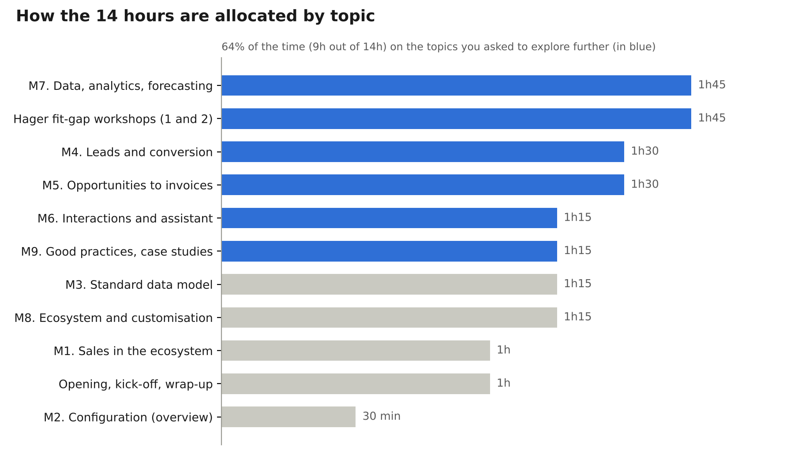

# Dynamics 365 Sales Training Programme

*Product Owner / Business Analyst level · 2 days on site (14 hours)*

ARCHIA365

## Context and positioning

This 2-day on-site training course (14 hours) is designed for the Product Owners and Business Analysts of the Hager CRM team. It does not cover user navigation, administration or development: its aim is to build an understanding of standard Dynamics 365 Sales, of Microsoft’s design choices and of the gaps with the Hager CRM.

- **Audience:** Product Owners, Business Analysts, CRM business leads (8 to 10 participants recommended).
- **Format:** 2 days on site, 9:00 to 17:30, approximately 30% demonstrations, 40% presentations and 30% workshops.
- **Running case:** ARCHIFRIDAYS, a fictitious international group operating in the same field as Hager Group: solutions and services for electrical installations (power distribution, building management, e-mobility). It sells through distributors, works with installers and specifiers (engineering consultancies, property developers) and manages commercial building projects and key accounts. Like Hager, it sells through two channels: **Diffuse** (account management for installers and distributors) and **Project** (projects followed with specifiers and influencers), which makes it possible to transpose the scenarios directly to the Hager context.
- **Guiding principle:** each module answers three questions: what does the standard offer, why did Microsoft design it this way, and what does Hager do today.

The full running case scenario, episode by episode, is described in the “ARCHIFRIDAYS Running Case” document.

## Learning objectives

By the end of the 2 days, participants will be able to:

1.  Distinguish between what belongs to standard Dynamics 365 Sales and what is specific to the Hager CRM.
2.  Describe the end-to-end sales process offered by Microsoft, from lead to invoice, and the logic of the associated data model.
3.  Identify the native features not used today and their business value.
4.  Use the native capabilities for reporting, sales performance analysis and sales forecasting.
5.  Position the contributions of the Microsoft ecosystem (Power Platform, Teams, Outlook, Power BI, Copilot) within a business process, without going into configuration.
6.  Challenge a business requirement using a “standard first” grid and make the case to business teams, architects and integrators.
7.  Produce an initial map of the standard / Hager gaps and their implications.

## Time allocation

Allocation of the 14 hours by theme (excluding breaks and lunches)

Time has been reallocated based on your feedback: configuration, dashboards, and accounts and contacts are covered in summary form, in favour of the sales process, analytics and lessons learned.

## Day 1: standard Dynamics 365 Sales and the end-to-end sales process

Day 1 is dedicated to the “what” and the “why” of the standard, with extra time on the lead, opportunity, quote, order, invoice cycle.

| Time        | Module                                            | Content                                                                                                                                                                                                                                                                                                                                                                                                    | Format                  |
|-------------|---------------------------------------------------|------------------------------------------------------------------------------------------------------------------------------------------------------------------------------------------------------------------------------------------------------------------------------------------------------------------------------------------------------------------------------------------------------------|-------------------------|
| 9:00-9:30   | Opening                                           | Round-table introductions, expectations, 10-minute presentation of the Hager CRM by the participants (processes, volumes, main customisations)                                                                                                                                                                                                                                                             | Discussion              |
| 9:30-10:30  | M1. Dynamics 365 Sales in the ecosystem           | Dataverse and model-driven apps, Sales Hub, licence tiers (Professional, Enterprise, Premium) and what they unlock, half-yearly update cycle (release waves), native features that are often under-used                                                                                                                                                                                                    | Presentation + demo     |
| 10:30-10:45 | Break                                             |                                                                                                                                                                                                                                                                                                                                                                                                            |                         |
| 10:45-11:15 | M2. Configuration: overview                       | Security (business units, security roles, teams, column security profiles, hierarchy): what can be configured by role and its business impact. Dashboards: quick refresher                                                                                                                                                                                                                                 | Summary presentation    |
| 11:15-12:30 | M3. The standard sales data model                 | Accounts and contacts (summary), leads, opportunities, quotes, orders, invoices, product catalogue (product families, price lists, unit groups), competitors, connection roles, activities. Logic of relationships and conversions. Side-by-side reading with the Hager model                                                                                                                              | Presentation + workshop |
| 12:30-13:30 | Lunch                                             |                                                                                                                                                                                                                                                                                                                                                                                                            |                         |
| 13:30-15:00 | M4. Lead management and conversion to opportunity | Lead sources and life cycle, qualification and disqualification, duplicate detection, “Lead to Opportunity Sales Process” business process flow, conversion (account, contact, opportunity), predictive lead scoring and sequences (Premium). ARCHIFRIDAYS scenario: lead from a trade show for the electrical equipment of an office building, with a specifying engineering consultancy and an installer | Demo + business case    |
| 15:00-15:15 | Break                                             |                                                                                                                                                                                                                                                                                                                                                                                                            |                         |
| 15:15-16:45 | M5. Opportunities, quotes, orders and invoices    | Pipeline and stages, estimates and probabilities, opportunity products, system-calculated or user-provided pricing, quote life cycle (draft, active, revision, won), order and invoice, CRM / ERP boundary and the related architecture choices. End-to-end demonstration                                                                                                                                  | Demo + discussion       |
| 16:45-17:30 | Workshop 1. Sales process fit-gap                 | Standard / Hager matrix step by step: fit, justified gap, gap to challenge. Initial implications (maintenance cost, compatibility with new Microsoft features)                                                                                                                                                                                                                                             | Workshop in sub-groups  |

## Day 2: interactions, performance management, ecosystem and lessons learned

Day 2 broadens the scope to customer relationship tracking, sales performance management and the Microsoft ecosystem, then devotes the afternoon to best practices and the Hager context.

| Time        | Module                                                 | Content                                                                                                                                                                                                                                                                                                                                                                                             | Format                         |
|-------------|--------------------------------------------------------|-----------------------------------------------------------------------------------------------------------------------------------------------------------------------------------------------------------------------------------------------------------------------------------------------------------------------------------------------------------------------------------------------------|--------------------------------|
| 9:00-9:15   | Day 2 kick-off                                         | Open questions from Day 1, points of attention raised in the fit-gap workshop                                                                                                                                                                                                                                                                                                                       | Discussion                     |
| 9:15-10:30  | M6. Interaction tracking and relationship intelligence | Activities (email, phone call, appointment, task) and timeline, server-side synchronization with Exchange, tracking of Outlook emails and appointments, Assistant (insight cards) and its evolution towards Copilot, relationship analytics, Sales accelerator and work list. What is captured automatically versus entered manually                                                                | Demo + business case           |
| 10:30-10:45 | Break                                                  |                                                                                                                                                                                                                                                                                                                                                                                                     |                                |
| 10:45-12:30 | M7. Data, analytics and forecasting                    | Native reporting (views, charts, dashboards, pipeline view), sales performance analysis, Goals, sales forecasting: hierarchy, forecast categories, adjustments, premium forecasting (Premium). Role of Power BI, including for forecast history (export or forecasting API to the data platform). KPIs typically implemented in Sales projects. Workshop: define 8 target KPIs for sales management | Presentation + demo + workshop |
| 12:30-13:30 | Lunch                                                  |                                                                                                                                                                                                                                                                                                                                                                                                     |                                |
| 13:30-14:45 | M8. Microsoft ecosystem and customisation: overview    | Teams (collaboration on records, sharing), Outlook, Power Automate (example: discount approval workflow), Power Apps (field companion app), Copilot in Dynamics 365 Sales and Copilot Studio agents, Power BI. Customisation of tables and columns: Dataverse principles, solutions, configuration / low-code / pro-code levels, impact on updates. ERP integration: options and trade-offs         | Presentation + use cases       |
| 14:45-15:00 | Break                                                  |                                                                                                                                                                                                                                                                                                                                                                                                     |                                |
| 15:00-16:15 | M9. Best practices and case studies                    | Lessons learned from Dynamics 365 Sales projects (manufacturing, electrical equipment, multi-party B2B distribution), common mistakes (over-customisation, technical debt, adoption), “stay standard or customise” decision tree, governance of changes, the Product Owner’s stance towards business teams, architects and integrators                                                              | Presentation + discussion      |
| 16:15-17:15 | Workshop 2. Summary of Hager gaps                      | Consolidation of the gaps identified over the 2 days, impact / effort positioning, 3 to 5 priority improvement opportunities, question grid for challenging a business requirement                                                                                                                                                                                                                  | Group workshop                 |
| 17:15-17:30 | Wrap-up                                                | Review, end-of-course evaluation, possible next steps                                                                                                                                                                                                                                                                                                                                               | Discussion                     |

## Methods, prerequisites and deliverables

Demonstrations are carried out on a standard Dynamics 365 Sales Enterprise environment, with Premium features shown as options, populated with the ARCHIFRIDAYS running case data, in order to show the product without customisation.

**Preparation with Hager:**

- A 60 to 90-minute alignment call, about 10 days before the session, to review the Hager documentation (Account, Appointment, Project Spider, Opportunity and Leads customisations), the integrations and the 3 to 5 use cases to address in the workshops.
- Information already received: Dynamics 365 Sales Enterprise licence; SAP, Eloqua and Power BI integrations.

**Deliverables provided to participants:**

- Training materials and summary sheets for each module.
- Standard / Hager fit-gap matrix completed during the workshop.
- Sales KPI reference framework and “standard first” grid for challenging a requirement.

**Assessment:** positioning quiz at the opening, assessment of learning through the workshops, end-of-course satisfaction questionnaire.

## How your feedback has been taken into account

| Your feedback                                                                                                 | Response in the programme                                                                                   |
|---------------------------------------------------------------------------------------------------------------|-------------------------------------------------------------------------------------------------------------|
| Product Owner / Business Analyst level, not user, administrator or developer                                  | Each module starts from the “why” of the standard; no transactional hands-on work or advanced configuration |
| Standard processes, unused native features, best practices                                                    | M1 and M3, then systematic identification in each module                                                    |
| Users, roles, permissions: overview                                                                           | M2, 30 minutes, focused on what can be configured by role                                                   |
| Dashboards already mastered                                                                                   | Quick refresher in M2, then analytical use in M7                                                            |
| Accounts and contacts already mastered                                                                        | Covered in summary form in M3                                                                               |
| More time on interactions, relationship assistant, leads, conversion, opportunities, quotes, orders, invoices | M4, M5 and M6: 4 hours 15 minutes in total, with an end-to-end demonstration                                |
| Reporting, performance, forecasting, KPIs                                                                     | M7: 1 hour 45 minutes with a KPI workshop                                                                   |
| Entity customisation: general overview                                                                        | M8, principles and impact only                                                                              |
| Power Platform: business use cases without development                                                        | M8, illustrated use cases                                                                                   |
| Best practices, lessons learned, standard versus specific                                                     | M9 and the two workshops: 3 hours in total                                                                  |
| Link with the Hager context and its gaps                                                                      | Day 1 opening, Workshop 1 and Workshop 2                                                                    |
