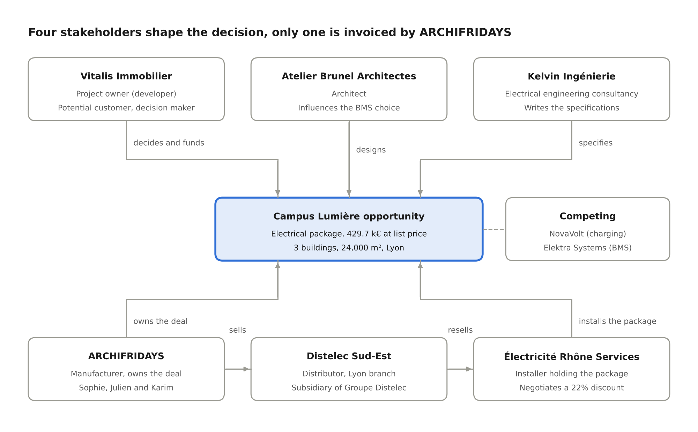

# ARCHIFRIDAYS running case

*Scenario for the Dynamics 365 Sales training, Product Owner / Business Analyst level*

ARCHIA365

A single scenario, the Campus Lumière project, follows an ARCHIFRIDAYS deal from first contact to quarterly performance management and feeds every module across the two days. All organisations, people and data are fictitious.

## The ARCHIFRIDAYS group

ARCHIFRIDAYS is a fictitious international industrial group supplying solutions and services for electrical installations in residential, commercial and industrial buildings. Its sales model is indirect: it sells to distributors, but the decision is shaped by installers, engineering consultancies and project owners.

### Company profile

| Item                              | Value                                                                                                                                                                                                                                                                                             |
|-----------------------------------|---------------------------------------------------------------------------------------------------------------------------------------------------------------------------------------------------------------------------------------------------------------------------------------------------|
| Headquarters                      | Obernai (67, France), subsidiaries in 30 countries                                                                                                                                                                                                                                                |
| Key locations                     | Paris (75): France sales management and key accounts; Blieskastel (Saarland, Germany): ARCHIFRIDAYS Deutschland subsidiary; Frankfurt: DACH key accounts office                                                                                                                                   |
| Revenue                           | 1.9 bn€, of which 38% in France                                                                                                                                                                                                                                                                   |
| Headcount                         | 11,000 employees, 420 sales staff in France                                                                                                                                                                                                                                                       |
| Business areas                    | Power distribution (switchboards, protection devices, enclosures), building management (home automation, KNX, access control), e-mobility and energy (charging stations, solar, storage)                                                                                                          |
| Services                          | Commissioning, maintenance contracts, installer training, remote monitoring                                                                                                                                                                                                                       |
| Sales channels                    | Two channels: **Diffuse** (account management for installers and distributors; electrical equipment distributors account for 85% of France revenue) and **Project** (commercial building projects followed with specifiers and influencers); plus direct key accounts and professional e-commerce |
| CRM licence                       | Dynamics 365 Sales Enterprise                                                                                                                                                                                                                                                                     |
| Applications connected to the CRM | SAP ERP (accounts, projects, quotes), Eloqua (leads, contacts), Power BI, data platform, event management tool (campaigns, campaign responses), Lead App (lead capture at trade shows)                                                                                                            |

### Sales organisation in France

France sales management, based in Paris, organises sales around two channels, as Hager does.

**Diffuse channel: account management for installers and distributors.**

- **Distribution key accounts:** Key Account Managers (including Julien Bernard) who negotiate annual framework agreements and pricing terms with distributors.
- **Installer field sales:** sales representatives (including Karim Haddad) who support installers, organise training and generate demand.

**Project channel: projects with specifiers and influencers.**

- **Specification and projects:** project managers (including Sophie Leroy) who follow commercial building projects above 100 k€ with engineering consultancies, architects and developers. Campus Lumière is this channel’s flagship project.

**Cross-functional teams.**

- **France sales management (Paris):** 4 regions (North-East, Île-de-France, West, South), a sales controlling team.
- **Inside sales:** qualification of inbound leads and phone follow-ups.
- **Sales administration (ADV):** entry and tracking of project orders, interface with SAP.
- **Marketing:** trade shows (leads captured with the Lead App), webinars, campaigns aimed at installers (Eloqua, event management tool).

### Personas

| Persona        | Role                                 | Channel                  | What they expect from the CRM                                                          |
|----------------|--------------------------------------|--------------------------|----------------------------------------------------------------------------------------|
| Claire Martin  | Sales Director France                | Cross-functional (Paris) | A reliable forecast every Monday, without Excel consolidation                          |
| Julien Bernard | Distribution Key Account Manager     | Diffuse                  | A 360° view of his distributors and the deals that go through them                     |
| Sophie Leroy   | Specification project manager        | Project                  | Track a project over 18 months with several stakeholders and several quotes            |
| Karim Haddad   | Installer field sales representative | Diffuse                  | Enter data quickly in the field, find the history before a visit                       |
| Nadia Benali   | Marketing officer                    | Cross-functional         | Measure what a trade show brings in, from lead to order                                |
| Émilie Roux    | Sales administration manager         | Cross-functional         | Complete quotes that are consistent with SAP                                           |
| Lucas Fontaine | Inside sales                         | Cross-functional         | Qualify inbound leads quickly using shared criteria                                    |
| Thomas Petit   | CRM Product Owner                    | Cross-functional         | Arbitrate between business requests, the Microsoft standard and the maintenance budget |

### Starting point

The ARCHIFRIDAYS CRM is a heavily customised Dynamics 365 Sales Enterprise, deployed in 2019 for 600 users. The executive committee has launched the “Back to Standard 2027” programme, whose roadmap is owned by Thomas Petit. Six pain points serve as the starting point:

1.  **“Project Web” table:** a custom table captures the parties involved in each project (specifiers, installers, distributors) and their role, in parallel with the standard stakeholders and connection roles.
2.  **Opportunity:** 140 custom columns to manage projects, a third of which are no longer filled in; a redesign of the entity is under way.
3.  **Account:** the account plan, the customer qualification by product range (self-declared) and the share of wallet are held in custom columns.
4.  **Leads:** three sources (Eloqua, the trade show Lead App, manual entry), a recently customised entity and no single source rule: the return on investment of trade shows is not measured.
5.  **Quotes and forecast in Excel:** quotes are built in Excel and then re-entered in SAP by sales administration; the forecast is consolidated by hand every week by sales controlling.
6.  **Interactions:** customer emails stay in individual Outlook mailboxes, outside the CRM; meeting objectives are entered in a custom column.

### Mapping to the Hager context

The table maps each element of the running case to its equivalent in the context provided by Hager. These mappings are working assumptions: confirm them with the participants, and during the alignment call, before presenting them as findings.

| ARCHIFRIDAYS element                                                | Hager equivalent                                                              | Where it is covered             |
|---------------------------------------------------------------------|-------------------------------------------------------------------------------|---------------------------------|
| Diffuse channel (Julien Bernard, Karim Haddad)                      | Diffuse channel: Account Management, mainly installers and distributors       | Episodes 2, 6 and 7; Workshop 1 |
| Project channel (Sophie Leroy, Campus Lumière)                      | Project channel: projects with specifiers, influencers and other stakeholders | Episodes 3, 5 and 9; Workshop 1 |
| Dynamics 365 Sales Enterprise licence, request for Premium features | Dynamics 365 Sales Enterprise licence                                         | Episode 1                       |
| “Project Web” table                                                 | Project Spider                                                                | Episodes 3 and 9; fit-gap grid  |
| Opportunity with 140 columns, redesign under way                    | Opportunity fully customised for projects, redesign under way                 | Episodes 3, 5 and 8             |
| Account plan, qualification by product range, share of wallet       | Account Plan, Customer Qualification, Share of wallet                         | Episodes 3, 7 and 9             |
| Leads from three sources (Eloqua, Lead App, manual entry)           | Recently customised Leads, Eloqua, Lead App, Event Management Tool            | Episode 4                       |
| Quotes re-entered in SAP                                            | SAP (accounts, projects, quotes)                                              | Episodes 5 and 8                |
| Meeting objectives in a custom column                               | Meeting Objectives on the Appointment                                         | Episode 6                       |
| Excel forecast, Power BI, data platform                             | Power BI, data platform                                                       | Episode 7                       |

## The Campus Lumière project and its stakeholders

Campus Lumière project stakeholders

The decision is shaped at the top (project owner, architect, engineering consultancy); the sales flow runs at the bottom, from ARCHIFRIDAYS to the distributor and then to the installer. This separation is at the heart of episodes 3 and 5: who to record as the potential customer, and who to link as a stakeholder.

## Demo dataset

The demo environment is a Dynamics 365 Sales Enterprise with no customisation, loaded before the session with the data from the “05_Dataset” folder. The Campus Lumière project covers 3 office buildings (24,000 m²) in Lyon, with delivery planned in the third quarter of 2028. The scenario reference date is Monday 16 November 2026.

### Accounts

| Account                          | Relationship type                   | Role in the running case                                                                |
|----------------------------------|-------------------------------------|-----------------------------------------------------------------------------------------|
| Vitalis Immobilier               | Customer (project owner)            | Developer of Campus Lumière, decides and funds                                          |
| Kelvin Ingénierie                | Specifier (engineering consultancy) | Writes the specifications for the electrical package                                    |
| Atelier Brunel Architectes       | Specifier (architect)               | Designs the building, influences the choice of building management system               |
| Électricité Rhône Services (ERS) | Customer (installer)                | Holder of the electrical package, negotiates prices                                     |
| Groupe Distelec                  | Distributor, parent account         | National framework agreement with ARCHIFRIDAYS                                          |
| Distelec Sud-Est                 | Distributor, child account          | Lyon branch that delivers to and invoices ERS                                           |
| NovaVolt                         | Competitor                          | Charging station specialist, aggressive pricing                                         |
| Elektra Systems                  | Competitor                          | Generalist in main LV switchboards and building management, already listed with Vitalis |

The full dataset contains 18 accounts: it adds the customers of the other deals in the pipeline (Logisud, Alpes Élec, VoltPark Exploitation, Foncière Arcades, Ville de Sainte-Aurore, Région Rhône-Sud, Habitat Rhodanien, Nexadata, Méca-Rhône, Clinique Saint-Roch).

### Key contacts

| Contact        | Account                    | Job title              | Specific point for the scenario                       |
|----------------|----------------------------|------------------------|-------------------------------------------------------|
| Marc Duval     | Vitalis Immobilier         | Programme Director     | Final decision maker                                  |
| Inès Garnier   | Kelvin Ingénierie          | Power systems engineer | Source of the trade show lead; joins Vitalis on day 2 |
| Hugo Blanc     | Kelvin Ingénierie          | Project manager        | Replaces Inès on the project                          |
| Léa Brunel     | Atelier Brunel Architectes | Partner architect      | Sensitive to the look of the charging stations        |
| Paul Lefèvre   | ERS                        | Managing director      | Asks for a 22% discount                               |
| Sandrine Morel | Distelec Sud-Est           | Branch manager         | Approves delivery terms                               |

### Product catalogue

| Family              | Product                                   | Unit             | 2026 public list price |
|---------------------|-------------------------------------------|------------------|------------------------|
| Power distribution  | Main low voltage switchboard (TGBT) 630 A | Unit             | 18,500 €               |
| Power distribution  | Distribution board 250 A                  | Unit             | 4,200 €                |
| Building management | Multi-building BMS monitoring pack        | Unit             | 48,000 €               |
| E-mobility          | Dual charging station 2 x 22 kW           | Unit             | 2,900 €                |
| Services            | On-site commissioning                     | Day              | 950 €                  |
| Services            | Charging station maintenance contract     | Station per year | 180 €                  |

Three price lists are loaded: **Public price list 2026**, **Distributor framework agreement price list** (32% discount on the public price list) and **Project price list** (net prices negotiated deal by deal).

### Campus Lumière electrical package breakdown

| Product                   | Quantity              | Public list amount |
|---------------------------|-----------------------|--------------------|
| Main LV switchboard 630 A | 3                     | 55,500 €           |
| Distribution board 250 A  | 24                    | 100,800 €          |
| BMS monitoring pack       | 1                     | 48,000 €           |
| Dual station 2 x 22 kW    | 60                    | 174,000 €          |
| Commissioning             | 20 days               | 19,000 €           |
| Station maintenance       | 60 stations x 3 years | 32,400 €           |
| **Total**                 |                       | **429,700 €**      |

Quote V1 with a 15% discount: 365,245 €. Quote V2 with a 20% discount: 343,760 €.

## Day 1: from organisation to project

Day 1 follows Campus Lumière from the trade show to the revised quote. Each episode follows the same pattern: situation, standard demo, Product Owner questions, applying it to the Hager context.

### Episode 0: “Back to Standard 2027” (opening, 9:00-9:30)

**Situation.** Thomas Petit, CRM Product Owner, opens the “Back to Standard 2027” programme. The executive committee asks him to halve the CRM maintenance cost without degrading the service provided to sales staff.

**Running order.**

1.  The trainer introduces ARCHIFRIDAYS, its personas and the 6 initial pain points.
2.  Each participant writes on 3 sticky notes the Hager CRM pain points that are most similar.
3.  The sticky notes are grouped by sales cycle stage on a wall that will be used for both workshops.

**Applying it to Hager.** The pain point wall becomes the “Current practice” column of the fit-gap grid. Question for the group: do the sticky notes relate more to the Diffuse channel or to the Project channel? Do Project Spider, the opportunity redesign or the recently customised leads appear among the pain points mentioned?

### Episode 1: which app, which licence? (M1, 9:30-10:30)

**Situation.** Claire Martin wants a predictive forecast and automatic lead scoring. ARCHIFRIDAYS holds a Dynamics 365 Sales Enterprise licence, but both requests concern Premium features, outside the current licence. Thomas needs to know what is already covered by the Enterprise licence and what requires a higher tier.

**Standard demo.**

1.  Sales Hub: site map, Sales, Collateral, Marketing and Performance areas.
2.  Positioning of the Sales Professional, Enterprise and Premium tiers against the features requested by Claire: Predictive lead scoring and Premium forecasting belong to Premium; native Forecasting, Goals and Copilot in Dynamics 365 Sales are available with Enterprise (subject to regional availability). The split changes with each release wave: check the licensing guide.
3.  Release plans: how a feature moves from preview to general availability.
4.  Quick tour of often under-used native features: Pipeline view, Sales accelerator, Copilot in Dynamics 365 Sales, and, as a Premium option, Relationship analytics.

**Questions for the PO / BA.**

- Which features requested by Claire exist natively, and with which licence?
- Does the expected gain justify moving to Premium, for all users or only some of them?
- Which current ARCHIFRIDAYS customisation could be replaced by a native feature released since 2019?
- Who in the organisation follows the Microsoft release plans?

**Applying it to Hager.** Participants complete a “native known / native unknown / native disabled” inventory for their own CRM. According to the information received, Hager also holds a Sales Enterprise licence: are Hager business teams already asking for Premium features, and which of them could be approached with Copilot in Dynamics 365 Sales or Power BI?

### Episode 2: who sees what? (M2, 10:45-11:15)

**Situation.** Sophie Leroy (Project channel, South-East region) must see Julien Bernard’s (Diffuse channel) deals with Distelec, but not the discount rates of the national framework agreement.

**Standard demo.**

1.  France and South-East business units, “Salesperson” security role and privilege scope.
2.  Access team on the Groupe Distelec account.
3.  Column security profile on the framework agreement discount rate.
4.  Manager hierarchy: Claire sees the deals of her whole team.
5.  5-minute reminder on personal and system dashboards.

**Questions for the PO / BA.**

- Does Sophie’s need call for a security role, a team or one-off sharing?
- Which data is really confidential, and for whom?
- What does an overly granular security model cost in terms of updates and support?

**Applying it to Hager.** One-page outline of the Hager visibility model: who sees what, and why. Do Hager’s Diffuse and Project channels call for different visibility rules, for example on a distributor’s Account Plan or Share of wallet?

### Episode 3: modelling Campus Lumière (M3, 11:15-12:30)

**Situation.** Five organisations are involved in Campus Lumière. In 2019, ARCHIFRIDAYS created a custom “Project Web” table that links each project to the parties involved (specifiers, installers, distributors) and their role, in parallel with the standard stakeholders and connection roles. As a result, the same parties are sometimes entered twice, sometimes not at all. Thomas must decide whether to keep it, while the opportunity redesign is under way.

**Standard demo.**

1.  Accounts and contacts in summary: Groupe Distelec and Distelec Sud-Est hierarchy, primary contact, timeline overview.
2.  Campus Lumière opportunity: potential customer, stakeholders, sales team, competitors.
3.  Connection roles: “Specifier”, “Appointed installer”, “Delivering distributor”.
4.  Catalogue: product families, unit groups, price lists, opportunity products.
5.  Table sequence: lead, opportunity, quote, order, invoice.
6.  Groupe Distelec account: where should the account plan, the qualification by product range and the share of wallet go? The standard has no complete native equivalent; these needs are “justified gap” candidates to discuss (columns, Goals, Power BI with SAP data, Copilot).

**Workshop (25 minutes).** In pairs, participants place the 5 project organisations in the standard model, then answer the key question: who is the potential customer of the opportunity, the developer, the installer or the distributor?

**Questions for the PO / BA.**

- What does the “Project Web” table provide that stakeholders, connection roles and the sales team do not?
- What does the company lose by keeping it: parties entered in a custom table remain invisible to Copilot, Relationship analytics and the standard views, which rely on stakeholders and connections.
- One project = one opportunity, or one project = one opportunity per competing installer?
- Is the opportunity redesign the right time to move the Project Web back to the standard?

**Applying it to Hager.** Participants list the custom tables in the Hager CRM that duplicate a standard table. Opening questions: at Hager, does Project Spider play the same role as the Project Web? What information does it hold that stakeholders and connection roles do not? Does the opportunity redesign take it into account?

### Episode 4: the 47 trade show leads (M4, 13:30-15:00)

**Situation.** Nadia Benali comes back from the BâtiExpo Lyon trade show with 47 badges scanned in the Lead App. The leads then pass through Eloqua before reaching the CRM: the same person can therefore exist in the Lead App, in Eloqua and in the CRM. Which is the source of truth, and where are duplicates handled? Among these leads, Inès Garnier (Kelvin Ingénierie) mentioned Campus Lumière and its 60 charging stations.

**Standard demo.**

1.  Import of the 47 leads (simulating the Lead App then Eloqua flow) with the “BâtiExpo Lyon 2026” campaign as source.
2.  Duplicate detection: Kelvin Ingénierie and Inès Garnier already exist, and Inès’s badge was scanned twice.
3.  Qualification by inside sales: budget, purchase timeframe, decision maker, need, “Lead to Opportunity Sales Process” business process flow.
4.  Disqualification of 2 leads (a student, a NovaVolt employee) with a standard reason.
5.  Qualification of Inès’s lead: creation of the opportunity, link to the existing account and contact.
6.  Point to watch: the conversion suggests Kelvin as the potential customer, whereas the decision maker is Vitalis.
7.  Sales accelerator: a follow-up sequence for the 30 scanned installers, assigned to Karim. As a Premium option, outside the Enterprise licence: Predictive lead scoring.

**Questions for the PO / BA.**

- Who qualifies: inside sales, marketing, field sales?
- Which is the source of truth for the lead, Eloqua or the CRM, and where is deduplication done?
- Which columns are really needed to qualify an installer lead (Diffuse channel), and a specifier lead (Project channel)?
- How do you measure the revenue generated by the trade show?

**Applying it to Hager.** Participants draw the current lifecycle of a Hager lead and compare it with the standard process. Points to question: the recently customised Lead entity, the Lead App, Eloqua, CRM journey, and the role of the Event Management Tool for campaigns and their responses. Where is deduplication done at Hager today, and who is responsible for it?

### Episode 5: from opportunity to invoice (M5, 15:15-16:45)

**Situation.** Sophie Leroy develops Campus Lumière. Paul Lefèvre (ERS) asks for a 22% discount; the sales policy requires Claire’s approval above 18%.

**Standard demo.**

1.  Opportunity business process flow: Qualify, Develop, Propose, Close.
2.  Adding the 6 product lines from the “Public price list 2026”: estimated revenue calculated by the system at 429,700 €.
3.  Adding the competitors NovaVolt and Elektra Systems, and the stakeholders.
4.  Quote V1 with a 15% discount (365,245 €): activation, Word template, sending by email from the CRM.
5.  ERS request: revision of the quote to V2 at 20% (343,760 €), revision history.
6.  Finding: the standard does not provide a discount approval workflow; it will be covered in M8 with Power Automate.
7.  Campus Lumière stays at the Propose stage with quote V2 sent. To show the end of the cycle, the trainer switches to the Entrepôt Logisud deal (ERS, 140 k€): quote won, order generated, handover to sales administration (who currently re-enter it in SAP), opportunity closed as won with its reason.
8.  Invoice: demo of the standard table, then discussion of the CRM / ERP boundary: SAP is the master for accounts; in which direction do quotes, orders and statuses flow?

**Questions for the PO / BA.**

- Where should price calculation live: CRM, SAP or a configure, price, quote tool?
- Deliveries spread until 2028: one order or several?
- Should the invoice exist in the CRM, or only its status brought back from SAP?
- What do you lose by building the quote in Excel and then re-entering it in SAP?

**Applying it to Hager.** Identifying, stage by stage, where the Hager process leaves the CRM. According to the information received, SAP holds Hager’s accounts, but also projects and quotes: at which stage does a project or a quote move into SAP, and what does the sales rep still see in the CRM? Does the opportunity redesign redraw this boundary?

### Workshop 1: sales process fit-gap (16:45-17:30)

**Instructions.** Participants split into 2 sub-groups, one per channel: the **Diffuse** sub-group works on an installer or distributor account (the point of view of Julien Bernard and Karim Haddad), the **Project** sub-group on a multi-stakeholder project (the point of view of Sophie Leroy and Campus Lumière). Each completes the fit-gap grid (“Workshop_Fit_Gap.xlsx” workbook) for the lead, opportunity, quote, order and invoice stages: first for ARCHIFRIDAYS, supported by the answer key, then for Hager.

**Deliverable.** A first Hager grid with, for each gap, the channel concerned (Diffuse / Project), its qualification and an implication.

## Day 2: from customer relationship to performance management

Day 2 picks up Campus Lumière a few weeks later, then widens to performance management for the South-East region and to the decisions of the “Back to Standard 2027” programme.

### Recap: Claire’s Monday morning (9:00-9:15)

**Situation.** On Monday 16 November 2026, Claire Martin opens the CRM and asks three questions: where does Campus Lumière stand, what is my quarter worth, and why do I still have an Excel workbook? The three questions structure the day.

### Episode 6: three weeks of silence (M6, 9:15-10:30)

**Situation.** Quote V2 was sent on 26 October, but no activity has been recorded on Campus Lumière for 21 days. In the meantime, Inès Garnier has left Kelvin Ingénierie to join Vitalis Immobilier, and NovaVolt has presented a charging station offer to Marc Duval.

**Standard demo.**

1.  Opportunity timeline: emails, phone calls, appointments, notes, posts.
2.  Tracking an email from Inès in Outlook with the Dynamics 365 App for Outlook, linked to the opportunity.
3.  Server-side synchronization: what is automatically brought in from Exchange and what stays private.
4.  Assistant insight cards: opportunity with no activity, unanswered email, close date approaching.
5.  As a Premium option, outside the Enterprise licence: Relationship analytics (health of the relationship with Vitalis, key contacts, who knows whom).
6.  Copilot in Dynamics 365 Sales: opportunity summary and preparation of the meeting with Marc Duval. The objectives of this meeting are currently entered in the custom “Meeting objectives” column; the standard appointment offers subject, description and “Regarding”.
7.  Sales accelerator: Karim’s work list and the follow-up sequence for the trade show installers.
8.  Updating Inès’s contact: new account, history kept.

**Questions for the PO / BA.**

- Which interactions should be captured automatically, and which should be entered manually?
- What do you do when a contact changes company: new contact or update?
- What confidentiality rules apply to synchronised emails?
- What data entry effort is acceptable for a field sales representative?
- Do meeting objectives justify a custom column (light justified gap), or are subject, description and Copilot enough?

**Applying it to Hager.** Participants measure the share of Hager customer communications that currently stay outside the CRM. Are the Meeting Objectives entered on the Hager Appointment read again after the meeting, and by whom? Does the Diffuse channel, with many installer visits, have the same capture needs as the Project channel?

### Episode 7: the Monday forecast (M7, 10:45-12:30)

**Situation.** The South-East region has a target of 1.6 M€ for the fourth quarter of 2026. Sales controlling consolidates an Excel workbook every week. Claire wants to replace it with native forecasting (data below and participant version of the “Forecast_and_KPI_Exercise_Q4” workbook).

**Standard demo.**

1.  Views and charts: open opportunities by stage, by owner, by product family.
2.  Pipeline view and funnel chart.
3.  Goals: quarterly goals for Sophie, Julien and Karim, and their achievement.
4.  Configuring a forecast: manager hierarchy, quarterly period, Pipeline, Best case, Committed, Omitted and Won categories.
5.  Forecast grid: reading by sales representative, drilling into underlying opportunities, inline editing.
6.  Claire’s manual adjustment on Sophie’s row, with a comment.
7.  Forecast history: the forecasting feature keeps no usable history (forecast snapshots, deal flow and trend history were deprecated by Microsoft in 2024). Week-over-week evolution is built outside the feature: export or forecasting API to the data platform, then a Power BI report.
8.  As a Premium option, outside the Enterprise licence: Premium forecasting and forecast intelligence.
9.  Role of Power BI and the data platform: cross-functional reports (margin, product mix, SAP data).

**Exercise (30 minutes).** Using the pipeline, participants calculate the quarter’s expected landing, identify the 3 deals at risk and propose Claire’s adjustment. They then define 8 KPIs for sales management.

**Questions for the PO / BA.**

- Who sets the forecast category: the sales representative or a rule linked to the stage?
- Estimated revenue entered manually or calculated from the products?
- Which indicators stay in Power BI and which should be native?

**Applying it to Hager.** Participants compare the KPIs they defined with the existing Hager dashboards. Which Hager indicators already live in Power BI or in the data platform? Does the Share of wallet, which combines SAP data, belong in the CRM or in Power BI? Do the KPIs differ between the Diffuse channel and the Project channel?

### Episode 8: automating without coding (M8, 13:30-14:45)

**Situation.** Three requests land on Thomas’s desk: a discount approval workflow, a site visit app for Karim, and a new “Number of charging points” column on the opportunity.

**Demo and use cases.**

1.  Power Automate: above an 18% discount, an approval card reaches Claire in Teams; her response updates the quote.
2.  Teams: collaboration channel linked to Campus Lumière, opportunity sharing, project files.
3.  Power Apps: “Site visit” companion app with photos and visit report, built on the existing Dataverse tables.
4.  Copilot Studio: agent that answers installers’ questions about the progress of their deals.
5.  Customisation: is the requested column needed when the number of charging stations is already in the opportunity products?
6.  Solutions and environments: how a customisation moves from development to production.
7.  SAP integration: the order goes to SAP, the invoicing status comes back into the CRM.

**Questions for the PO / BA.**

- Configuration, low-code or development: which level for each request, and who maintains it?
- Is the stated need a disguised solution? What is the real need behind the column?
- Which master data stays in SAP?

**Applying it to Hager.** Participants classify 5 recent requests from the Hager backlog according to the three levels. Examples to look for: one more column on the opportunity during its redesign, a change to the Lead App to Eloqua flow, an addition to the Account Plan, an exchange with SAP or the Event Management Tool.

### Episode 9: three decisions for 2027 (M9, 15:00-16:15)

**Situation.** Thomas presents three decisions of the “Back to Standard 2027” programme to the executive committee. Each case is analysed with the same grid: context, options, recommendation, success factors.

| Case                | Current situation                                                                                                                         | Standard option                                                               | Recommendation                                                                                        | Success factor                                  |
|---------------------|-------------------------------------------------------------------------------------------------------------------------------------------|-------------------------------------------------------------------------------|-------------------------------------------------------------------------------------------------------|-------------------------------------------------|
| “Project Web” table | Custom table of the parties involved in a project and their role, running in parallel with the standard stakeholders and connection roles | Stakeholders, connection roles, sales team and competitors on the opportunity | Return to standard, with connection roles adapted to the business (specifier, installer, distributor) | Data migration and support for project managers |
| Excel quote         | Quote built in Excel, re-entered in SAP by sales administration                                                                           | Native quote, Word template, revisions                                        | Native quote for projects; configuration tool only if pricing rules require it                        | Reliable catalogue and price lists              |
| Excel forecast      | Workbook consolidated every week                                                                                                          | Native forecasting, goals                                                     | Native forecasting, Power BI for cross-functional analysis and forecast history                       | Discipline in updating dates and amounts        |

**Trainer input.** Common mistakes observed on Dynamics 365 Sales projects: replicating the old tool, one column per request, overly long business process flows, no owner for reference data, neglected adoption. “Stay standard or customise” decision tree, backlog governance and the PO’s stance towards the business, architects and the integrator.

**Applying it to Hager.** Each participant chooses a Hager customisation and runs it through the decision tree. Possible candidates, to be confirmed with the group: Project Spider, a column of the Account Plan or the Customer Qualification, the Share of wallet, the Meeting Objectives, a column of the opportunity being redesigned.

### Workshop 2: Hager gap summary (16:15-17:15)

**Instructions.** The group consolidates the day 1 grids (Diffuse and Project sub-groups) and the day 2 Hager applications, then places each gap on a business impact / effort to return to standard matrix.

**Deliverables.**

- The consolidated Hager fit-gap grid, with the channel concerned by each gap.
- 3 to 5 priority improvement areas, each with its expected benefit and conditions.
- The grid of questions for challenging a need, adapted to Hager vocabulary.

### Closing (17:15-17:30)

Review of Claire’s 3 questions: each participant states where the standard provides the answer, where Hager departs from it, and the first action they will own.

## South-East pipeline for the fourth quarter of 2026 (episode 7)

With 813 k€ won or committed against a target of 1,600 k€, the South-East region is only 51% covered; the best case brings coverage to 89%.

| Opportunity                                         | Potential customer         | Owner          | Stage   | Amount (k€) | Prob. (%) | Category  | Close date |
|-----------------------------------------------------|----------------------------|----------------|---------|-------------|-----------|-----------|------------|
| Entrepôt Logisud, power distribution                | Électricité Rhône Services | Karim Haddad   | Won     | 140         | 100       | Won       | 14/10/2026 |
| Hôtel Belvédère, home automation                    | Alpes Élec                 | Karim Haddad   | Won     | 62          | 100       | Won       | 22/10/2026 |
| Parking Confluence, 40 charging stations            | VoltPark Exploitation      | Julien Bernard | Close   | 125         | 90        | Committed | 05/11/2026 |
| Centre commercial Les Arcades, 3-year maintenance   | Foncière Arcades           | Julien Bernard | Close   | 76          | 80        | Committed | 15/11/2026 |
| Charging station framework agreement 2027           | Groupe Distelec            | Julien Bernard | Close   | 410         | 80        | Committed | 30/11/2026 |
| Ville de Sainte-Aurore, street charging stations    | Ville de Sainte-Aurore     | Sophie Leroy   | Propose | 88          | 60        | Best case | 28/11/2026 |
| Lycée Ampère, building management system            | Région Rhône-Sud           | Sophie Leroy   | Propose | 180         | 50        | Best case | 10/12/2026 |
| Campus Lumière, electrical package                  | Vitalis Immobilier         | Sophie Leroy   | Propose | 344         | 60        | Best case | 15/12/2026 |
| Clinique Saint-Roch, main LV switchboard renovation | Électricité Rhône Services | Karim Haddad   | Develop | 95          | 40        | Pipeline  | 20/12/2026 |
| Résidence Les Tilleuls, 120 homes                   | Habitat Rhodanien          | Sophie Leroy   | Qualify | 210         | 20        | Pipeline  | 18/12/2026 |
| Data center Vénissieux, main LV switchboard         | Nexadata                   | Julien Bernard | Develop | 290         | 30        | Pipeline  | 22/12/2026 |
| Usine Méca-Rhône, energy storage                    | Méca-Rhône                 | Karim Haddad   | Develop | 150         | 30        | Omitted   | 31/12/2026 |

### Summary by category

| Category  | Amount (k€) | Cumulative (k€)        | Target coverage |
|-----------|-------------|------------------------|-----------------|
| Won       | 202         | 202                    | 13%             |
| Committed | 611         | 813                    | 51%             |
| Best case | 612         | 1,425                  | 89%             |
| Pipeline  | 595         | 2,020                  | 126%            |
| Omitted   | 150         | excluded from forecast |                 |

**Points to watch for the exercise.**

- Campus Lumière: amount of 344 k€ taken from quote V2, but 21 days with no activity and a competing offer from NovaVolt.
- Distelec framework agreement: 410 k€ in “Committed”, i.e. half of the committed amount on a single deal.
- Usine Méca-Rhône: project postponed to 2027 by the customer, hence the “Omitted” category; should the close date be moved?
- Résidence Les Tilleuls: at the Qualify stage with a close date in December, is the date credible?
- Sophie Leroy has not yet won or committed anything against her 700 k€ target.

## Facilitation kit

### Fit-gap grid: ARCHIFRIDAYS answer key

This grid serves as the model for workshops 1 and 2; participants duplicate its structure for Hager (“Hager grid” sheet of the workshop workbook), stating for each gap the channel concerned (Diffuse / Project).

| Stage                     | Dynamics 365 Sales standard                                                                                                              | ARCHIFRIDAYS practice                                                            | Qualification                  | Implication                                                                             |
|---------------------------|------------------------------------------------------------------------------------------------------------------------------------------|----------------------------------------------------------------------------------|--------------------------------|-----------------------------------------------------------------------------------------|
| Lead capture              | Import with source campaign, duplicate detection                                                                                         | Three sources (Eloqua, trade show Lead App, manual entry), no single source rule | Gap to challenge               | Trade show return on investment not measured, duplicates across tools                   |
| Qualification             | Lead to Opportunity Sales Process, conversion to opportunity                                                                             | Recently customised lead entity, project opportunity created by hand             | Gap to challenge               | Double entry, lead history lost                                                         |
| Account                   | Account, account hierarchy, Goals; no complete native equivalent for the account plan, qualification by product range or share of wallet | Custom columns on the account                                                    | Justified gap, to be confirmed | Name the owner and the source of the data (manual entry, SAP, Power BI)                 |
| Multi-stakeholder project | Opportunity, stakeholders, connection roles, sales team, competitors                                                                     | Custom “Project Web” table, in parallel with stakeholders                        | Gap to challenge               | Parties invisible to Copilot and Relationship analytics; double entry with stakeholders |
| Opportunity               | Standard opportunity and business process flow                                                                                           | 140 custom columns, a third empty, redesign under way                            | Gap to challenge               | The redesign is the opportunity to return to standard                                   |
| Discount visibility       | Column security profile                                                                                                                  | Column security profile                                                          | Fit                            | None                                                                                    |
| Quote                     | Native quote, Word template, revisions                                                                                                   | Excel workbook, re-entered in SAP by sales administration                        | Gap to challenge               | Re-entry errors, no version history                                                     |
| Discount approval         | Not native, Power Automate extension                                                                                                     | Informal email to the director                                                   | Justified gap                  | Low-code extension to maintain, traceability gained                                     |
| Order                     | Order generated from the won quote                                                                                                       | Entered by sales administration in SAP                                           | Justified gap                  | CRM to SAP integration to plan                                                          |
| Invoice                   | Standard invoice table                                                                                                                   | SAP only                                                                         | Justified gap                  | Bring the invoicing status back into the CRM                                            |
| Forecast                  | Native forecasting, goals; history through export to Power BI                                                                            | Weekly Excel workbook consolidated by hand                                       | Gap to challenge               | One day of consolidation per week                                                       |
| Interactions              | Exchange synchronization, Outlook app                                                                                                    | Emails in individual mailboxes                                                   | Gap to challenge               | History lost when a sales representative leaves                                         |
| Appointments              | Standard appointment (subject, description, “Regarding”), preparation with Copilot                                                       | Custom “Meeting objectives” column                                               | Light justified gap            | Check that the column is used after the meeting                                         |

### Ten questions for challenging a need

1.  Which business problem does this need solve, and for whom?
2.  What happens today if nothing is done?
3.  Does the standard already cover all or part of the need, possibly with another licence?
4.  Is the need a disguised solution (“I need a column”)?
5.  How many users, and how often?
6.  Which decision or indicator will rely on this data?
7.  Who enters the data, and who owns it?
8.  Can the process adapt to the standard rather than the other way round?
9.  Which level of response: configuration, low-code or development, and who maintains it?
10. What is the impact on Microsoft’s twice-yearly release waves?

### Answer key elements

**Episode 3, who is the potential customer?** Vitalis Immobilier, which decides and funds. Kelvin, Atelier Brunel, ERS and Distelec Sud-Est are linked as stakeholders with a connection role: this is the standard equivalent of the Project Web. What the Project Web holds in addition (a business-specific role, an involvement period) is first handled with adapted connection roles, since connections also have start and end dates; a gap is only justified for a remaining, documented need. Variant to discuss: as long as the installer has not been appointed, one opportunity per competing installer, grouped under Vitalis.

**Episode 4, the conversion trap.** Converting Inès’s lead suggests Kelvin Ingénierie as the potential customer. The PO must decide whether the qualification rule requires the project owner to be entered at conversion. The PO must also name the source of truth for the lead (Eloqua or the CRM) and where deduplication between the Lead App, Eloqua and the CRM takes place.

**Episode 7, proposed landing.** About 1.08 M€ (68% of the target): won and committed (813 k€), plus Sainte-Aurore (88 k€) and Lycée Ampère (180 k€). Campus Lumière stays excluded until the meeting with Marc Duval has taken place. The 3 deals at risk are Campus Lumière, the Distelec framework agreement (concentration) and Résidence Les Tilleuls (date not very credible).

**Episode 7, example of 8 KPIs.**

1.  Lead to opportunity conversion rate, by source.
2.  Opportunity win rate, by number and by value.
3.  Average sales cycle length, by segment.
4.  Weighted pipeline and target coverage.
5.  Forecast accuracy: gap between forecast and actual.
6.  Average discount granted compared with the sales policy.
7.  Number of opportunities with no activity for more than 14 days.
8.  Share of project revenue with an identified specifier.

**Episode 8, the “Number of charging points” column.** Unnecessary: the information already exists in the opportunity product quantities. The real need is an indicator of the number of charging points sold, which is built in a view or a report.
