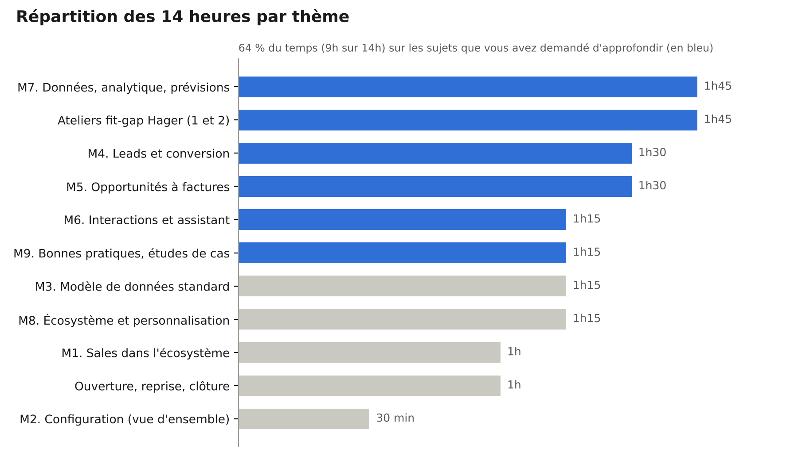

# Programme de formation Dynamics 365 Sales

*Niveau Product Owner / Business Analyst · 2 jours sur site (14 heures)*

ARCHIA365

## Contexte et positionnement

Cette formation de 2 jours sur site (14 heures) s’adresse aux Product Owners et Business Analysts de l’équipe CRM Hager. Elle ne traite ni la navigation utilisateur, ni l’administration, ni le développement : elle vise la compréhension du standard Dynamics 365 Sales, des choix de conception de Microsoft et des écarts avec le CRM Hager.

- **Public :** Product Owners, Business Analysts, référents métier CRM (8 à 10 participants recommandés).
- **Format :** 2 jours sur site, 9h00 à 17h30, environ 30 % de démonstrations, 40 % d’apports et 30 % d’ateliers.
- **Fil rouge :** ARCHIFRIDAYS, groupe international fictif du même domaine que Hager Group : solutions et services pour installations électriques (distribution d’énergie, gestion du bâtiment, mobilité électrique). Il vend via des distributeurs, travaille avec des installateurs et des prescripteurs (bureaux d’études, promoteurs) et gère des projets tertiaires et des comptes clés. Comme Hager, il vend par deux canaux : **Diffuse** (gestion de comptes des installateurs et distributeurs) et **Project** (projets suivis avec les prescripteurs et influenceurs), ce qui permet de transposer directement les scénarios au contexte Hager.
- **Principe directeur :** chaque module répond à trois questions : que propose le standard, pourquoi Microsoft l’a conçu ainsi, et que fait Hager aujourd’hui.

Le scénario complet du fil rouge, épisode par épisode, est détaillé dans le document « Fil rouge ARCHIFRIDAYS ».

## Objectifs pédagogiques

À l’issue des 2 jours, les participants seront capables de :

1.  Distinguer ce qui relève du standard Dynamics 365 Sales et ce qui est spécifique au CRM Hager.
2.  Décrire le processus commercial de bout en bout proposé par Microsoft, du lead à la facture, et la logique du modèle de données associé.
3.  Identifier les fonctionnalités natives non exploitées aujourd’hui et leur valeur métier.
4.  Exploiter les capacités natives de reporting, d’analyse de performance et de prévision commerciale (forecasting).
5.  Situer les apports de l’écosystème Microsoft (Power Platform, Teams, Outlook, Power BI, Copilot) dans un processus métier, sans entrer dans la configuration.
6.  Challenger un besoin métier avec une grille « standard d’abord » et argumenter face aux métiers, architectes et intégrateurs.
7.  Produire une première cartographie des écarts standard / Hager et de leurs implications.

## Répartition du temps

Répartition des 14 heures par thème (hors pauses et déjeuners)

Le temps a été réalloué selon vos retours : la configuration, les tableaux de bord et les comptes et contacts sont traités en synthèse au profit du processus de vente, de l’analytique et des retours d’expérience.

## Jour 1 : le standard Dynamics 365 Sales et le processus de vente de bout en bout

Le jour 1 est consacré au « quoi » et au « pourquoi » du standard, avec un temps renforcé sur le cycle lead, opportunité, devis, commande, facture.

| Horaire     | Module                                             | Contenu                                                                                                                                                                                                                                                                                                                                                                                                                | Format                  |
|-------------|----------------------------------------------------|------------------------------------------------------------------------------------------------------------------------------------------------------------------------------------------------------------------------------------------------------------------------------------------------------------------------------------------------------------------------------------------------------------------------|-------------------------|
| 9h00-9h30   | Ouverture                                          | Tour de table, attentes, présentation en 10 minutes du CRM Hager par les participants (processus, volumétrie, principales personnalisations)                                                                                                                                                                                                                                                                           | Échange                 |
| 9h30-10h30  | M1. Dynamics 365 Sales dans l’écosystème           | Dataverse et applications pilotées par modèle, Sales Hub, niveaux de licence (Professional, Enterprise, Premium) et ce qu’ils débloquent, cycle des mises à jour semestrielles (release waves), fonctionnalités natives souvent sous-exploitées                                                                                                                                                                        | Apport + démo           |
| 10h30-10h45 | Pause                                              |                                                                                                                                                                                                                                                                                                                                                                                                                        |                         |
| 10h45-11h15 | M2. Configuration : vue d’ensemble                 | Sécurité (unités commerciales, rôles, équipes, profils de sécurité de colonne, hiérarchie) : ce qui est paramétrable par rôle et ses impacts métier. Tableaux de bord : rappel rapide                                                                                                                                                                                                                                  | Apport synthétique      |
| 11h15-12h30 | M3. Le modèle de données commercial standard       | Comptes et contacts (synthèse), prospects, opportunités, devis, commandes, factures, catalogue produits (familles, listes de prix, unités), concurrents, rôles de connexion, activités. Logique des relations et des conversions. Lecture comparée avec le modèle Hager                                                                                                                                                | Apport + atelier        |
| 12h30-13h30 | Déjeuner                                           |                                                                                                                                                                                                                                                                                                                                                                                                                        |                         |
| 13h30-15h00 | M4. Gestion des leads et conversion en opportunité | Sources et cycle de vie du lead, qualification et disqualification, détection des doublons, processus d’entreprise « Lead to Opportunity », conversion (compte, contact, opportunité), notation prédictive des leads et séquences (Premium). Scénario ARCHIFRIDAYS : lead issu d’un salon professionnel pour l’équipement électrique d’un immeuble de bureaux, avec un bureau d’études prescripteur et un installateur | Démo + cas métier       |
| 15h00-15h15 | Pause                                              |                                                                                                                                                                                                                                                                                                                                                                                                                        |                         |
| 15h15-16h45 | M5. Opportunités, devis, commandes et factures     | Pipeline et étapes, estimations et probabilités, produits d’opportunité, prix calculé par le système ou saisi, cycle de vie du devis (brouillon, actif, révision, gagné), commande et facture, frontière CRM / ERP et choix d’architecture associés. Démonstration de bout en bout                                                                                                                                     | Démo + discussion       |
| 16h45-17h30 | Atelier 1. Fit-gap du processus de vente           | Matrice standard / Hager étape par étape : conforme, écart justifié, écart à questionner. Premières implications (coût de maintenance, compatibilité avec les nouveautés Microsoft)                                                                                                                                                                                                                                    | Atelier en sous-groupes |

## Jour 2 : interactions, pilotage, écosystème et retours d’expérience

Le jour 2 élargit au suivi de la relation client, au pilotage commercial et à l’écosystème Microsoft, puis consacre l’après-midi aux bonnes pratiques et au contexte Hager.

| Horaire     | Module                                                        | Contenu                                                                                                                                                                                                                                                                                                                                                                                                                                                                                   | Format                  |
|-------------|---------------------------------------------------------------|-------------------------------------------------------------------------------------------------------------------------------------------------------------------------------------------------------------------------------------------------------------------------------------------------------------------------------------------------------------------------------------------------------------------------------------------------------------------------------------------|-------------------------|
| 9h00-9h15   | Reprise                                                       | Questions ouvertes du jour 1, points de vigilance relevés dans l’atelier fit-gap                                                                                                                                                                                                                                                                                                                                                                                                          | Échange                 |
| 9h15-10h30  | M6. Suivi des interactions et intelligence relationnelle      | Activités (e-mail, appel, rendez-vous, tâche) et chronologie, synchronisation côté serveur avec Exchange, suivi des e-mails et rendez-vous Outlook, assistant relationnel (cartes d’insights) et son évolution vers Copilot, analyse des relations, accélérateur des ventes et liste de travail. Ce qui est capturé automatiquement versus saisi                                                                                                                                          | Démo + cas métier       |
| 10h30-10h45 | Pause                                                         |                                                                                                                                                                                                                                                                                                                                                                                                                                                                                           |                         |
| 10h45-12h30 | M7. Données, analytique et prévisions                         | Reporting natif (vues, graphiques, tableaux de bord, vue pipeline), analyse des performances commerciales, objectifs (Goals), prévisions commerciales : hiérarchie, catégories de prévision, ajustements, prévision prédictive (Premium). Place de Power BI, y compris pour l’historique de la prévision (export ou API de prévision vers la data platform). Indicateurs habituellement mis en œuvre dans les projets Sales. Atelier : définir 8 KPI cibles pour la direction commerciale | Apport + démo + atelier |
| 12h30-13h30 | Déjeuner                                                      |                                                                                                                                                                                                                                                                                                                                                                                                                                                                                           |                         |
| 13h30-14h45 | M8. Écosystème Microsoft et personnalisation : vue d’ensemble | Teams (collaboration sur les enregistrements, partage), Outlook, Power Automate (exemple : circuit d’approbation de remise), Power Apps (application compagnon terrain), Copilot dans Sales et agents Copilot Studio, Power BI. Personnalisation des tables et des colonnes : principes Dataverse, solutions, niveaux configuration / low-code / pro-code, impacts sur les mises à jour. Intégration ERP : options et arbitrages                                                          | Apport + cas d’usage    |
| 14h45-15h00 | Pause                                                         |                                                                                                                                                                                                                                                                                                                                                                                                                                                                                           |                         |
| 15h00-16h15 | M9. Bonnes pratiques et études de cas                         | Retours d’expérience de projets Dynamics 365 Sales (industrie, matériel électrique, distribution B2B multi-acteurs), erreurs fréquentes (sur-personnalisation, dette technique, adoption), arbre de décision « rester standard ou personnaliser », gouvernance des évolutions, posture du Product Owner face aux métiers, architectes et intégrateurs                                                                                                                                     | Apport + discussion     |
| 16h15-17h15 | Atelier 2. Synthèse des écarts Hager                          | Consolidation des écarts identifiés sur les 2 jours, positionnement impact / effort, 3 à 5 pistes d’amélioration prioritaires, grille de questions pour challenger un besoin métier                                                                                                                                                                                                                                                                                                       | Atelier collectif       |
| 17h15-17h30 | Clôture                                                       | Bilan, évaluation à chaud, suites possibles                                                                                                                                                                                                                                                                                                                                                                                                                                               | Échange                 |

## Méthodes, prérequis et livrables

Les démonstrations se font sur un environnement Dynamics 365 Sales Enterprise standard, les fonctions Premium étant montrées en option, alimenté avec les données du fil rouge ARCHIFRIDAYS, pour montrer le produit sans personnalisation.

**Préparation avec Hager :**

- Un call d’alignement de 60 à 90 minutes, environ 10 jours avant la session, pour passer en revue la documentation Hager (personnalisations Account, Appointment, Project Spider, Opportunité, Leads), les intégrations et les 3 à 5 cas d’usage à traiter en atelier.
- Informations déjà reçues : licence Dynamics 365 Sales Enterprise ; intégrations SAP, Eloqua et Power BI.

**Livrables remis aux participants :**

- Support de formation et fiches de synthèse par module.
- Matrice fit-gap standard / Hager complétée en atelier.
- Référentiel des KPI commerciaux et grille « standard d’abord » pour challenger un besoin.

**Évaluation :** quiz de positionnement en ouverture, évaluation des acquis par les ateliers, questionnaire de satisfaction à chaud.

## Prise en compte de vos retours

| Votre retour                                                                                                       | Réponse dans le programme                                                                                      |
|--------------------------------------------------------------------------------------------------------------------|----------------------------------------------------------------------------------------------------------------|
| Niveau Product Owner / Business Analyst, pas utilisateur, administrateur ni développeur                            | Chaque module part du « pourquoi » du standard ; aucune manipulation transactionnelle ni configuration avancée |
| Processus standards, fonctionnalités natives non utilisées, bonnes pratiques                                       | M1 et M3, puis repérage systématique dans chaque module                                                        |
| Utilisateurs, rôles, permissions : vue d’ensemble                                                                  | M2, 30 minutes, centré sur ce qui est paramétrable par rôle                                                    |
| Tableaux de bord déjà maîtrisés                                                                                    | Rappel rapide en M2, puis usage analytique en M7                                                               |
| Comptes et contacts déjà maîtrisés                                                                                 | Traités en synthèse dans M3                                                                                    |
| Plus de temps sur interactions, assistant relationnel, leads, conversion, opportunités, devis, commandes, factures | M4, M5 et M6 : 4h15 au total, avec démonstration de bout en bout                                               |
| Reporting, performance, forecasting, KPI                                                                           | M7 : 1h45 avec atelier KPI                                                                                     |
| Personnalisation des entités : présentation générale                                                               | M8, principes et impacts uniquement                                                                            |
| Power Platform : cas d’usage métier sans développement                                                             | M8, cas d’usage illustrés                                                                                      |
| Bonnes pratiques, retours d’expérience, standard versus spécifique                                                 | M9 et les deux ateliers : 3h au total                                                                          |
| Lien avec le contexte Hager et ses écarts                                                                          | Ouverture du jour 1, atelier 1 et atelier 2                                                                    |
