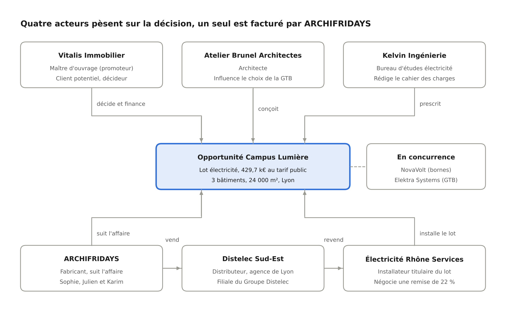

# Fil rouge ARCHIFRIDAYS

*Scénario de la formation Dynamics 365 Sales, niveau Product Owner / Business Analyst*

ARCHIA365

Un scénario unique, le projet Campus Lumière, suit une affaire d’ARCHIFRIDAYS du premier contact au pilotage trimestriel et alimente chacun des modules des deux jours. Toutes les organisations, personnes et données sont fictives.

## Le groupe ARCHIFRIDAYS

ARCHIFRIDAYS est un groupe industriel international fictif, fournisseur de solutions et de services pour les installations électriques des bâtiments résidentiels, tertiaires et industriels. Son modèle commercial est indirect : il vend aux distributeurs, mais la décision se construit chez les installateurs, les bureaux d’études et les maîtres d’ouvrage.

### Carte d’identité

| Repère                         | Valeur                                                                                                                                                                                                                                                                                                         |
|--------------------------------|----------------------------------------------------------------------------------------------------------------------------------------------------------------------------------------------------------------------------------------------------------------------------------------------------------------|
| Siège                          | Obernai (67, France), filiales dans 30 pays                                                                                                                                                                                                                                                                    |
| Implantations clés             | Paris (75) : direction commerciale France et grands comptes ; Blieskastel (Sarre, Allemagne) : filiale ARCHIFRIDAYS Deutschland ; Frankfurt : bureau grands comptes DACH                                                                                                                                       |
| Chiffre d’affaires             | 1,9 Md€, dont 38 % en France                                                                                                                                                                                                                                                                                   |
| Effectif                       | 11 000 collaborateurs, 420 commerciaux en France                                                                                                                                                                                                                                                               |
| Domaines d’activité            | Distribution d’énergie (tableaux, protections, coffrets), gestion technique du bâtiment (domotique, KNX, contrôle d’accès), mobilité électrique et énergie (bornes de recharge, solaire, stockage)                                                                                                             |
| Services                       | Mise en service, contrats de maintenance, formation des installateurs, supervision à distance                                                                                                                                                                                                                  |
| Canaux de vente                | Deux canaux : **Diffuse** (gestion de comptes des installateurs et distributeurs ; les distributeurs de matériel électrique pèsent 85 % du CA France) et **Project** (projets tertiaires suivis avec les prescripteurs et influenceurs) ; s’y ajoutent des comptes clés directs et un e-commerce professionnel |
| Licence CRM                    | Dynamics 365 Sales Enterprise                                                                                                                                                                                                                                                                                  |
| Applications connectées au CRM | ERP SAP (comptes, projets, devis), Eloqua (leads, contacts), Power BI, data platform, outil de gestion d’événements (campagnes, réponses de campagnes), Lead App (capture des leads sur les salons)                                                                                                            |

### Organisation commerciale France

La direction commerciale France, installée à Paris, organise la vente autour de deux canaux, comme Hager.

**Canal Diffuse : gestion de comptes des installateurs et distributeurs.**

- **Grands comptes distribution :** Key Account Managers (dont Julien Bernard) qui négocient les accords cadres annuels et les conditions tarifaires avec les distributeurs.
- **Terrain installateurs :** commerciaux (dont Karim Haddad) qui animent les installateurs, organisent les formations et génèrent la demande.

**Canal Project : projets avec prescripteurs et influenceurs.**

- **Prescription et projets :** chargés d’affaires (dont Sophie Leroy) qui suivent les projets tertiaires de plus de 100 k€ auprès des bureaux d’études, architectes et promoteurs. Campus Lumière est le projet phare de ce canal.

**Fonctions transverses.**

- **Direction commerciale France (Paris) :** 4 régions (Nord-Est, Île-de-France, Ouest, Sud), un contrôle de gestion commercial.
- **Inside sales :** qualification des leads entrants et relances téléphoniques.
- **Administration des ventes (ADV) :** saisie et suivi des commandes projets, interface avec SAP.
- **Marketing :** salons professionnels (leads captés avec la Lead App), webinaires, campagnes vers les installateurs (Eloqua, outil de gestion d’événements).

### Personas

| Persona        | Rôle                             | Canal              | Ce qu’il attend du CRM                                                      |
|----------------|----------------------------------|--------------------|-----------------------------------------------------------------------------|
| Claire Martin  | Directrice commerciale France    | Transverse (Paris) | Une prévision fiable chaque lundi, sans consolidation Excel                 |
| Julien Bernard | Key Account Manager distribution | Diffuse            | Une vue 360° de ses distributeurs et des affaires qui passent par eux       |
| Sophie Leroy   | Chargée d’affaires prescription  | Project            | Suivre un projet sur 18 mois avec plusieurs acteurs et plusieurs devis      |
| Karim Haddad   | Commercial terrain installateurs | Diffuse            | Saisir vite depuis le terrain, retrouver l’historique avant une visite      |
| Nadia Benali   | Chargée marketing                | Transverse         | Mesurer ce que rapporte un salon, du lead à la commande                     |
| Émilie Roux    | Responsable ADV                  | Transverse         | Des devis complets et cohérents avec SAP                                    |
| Lucas Fontaine | Inside sales                     | Transverse         | Qualifier vite les leads entrants avec des critères partagés                |
| Thomas Petit   | Product Owner CRM                | Transverse         | Arbitrer entre demandes métier, standard Microsoft et budget de maintenance |

### Situation de départ

Le CRM d’ARCHIFRIDAYS est un Dynamics 365 Sales Enterprise très personnalisé, déployé en 2019 pour 600 utilisateurs. Le comité de direction a lancé le programme « Retour au standard 2027 », dont Thomas Petit porte la feuille de route. Six irritants servent de point de départ :

1.  **Table « Toile projet » :** une table spécifique capture les intervenants de chaque projet (prescripteurs, installateurs, distributeurs) et leur rôle, en parallèle des parties prenantes et des rôles de connexion standard.
2.  **Opportunité :** 140 colonnes spécifiques pour gérer les projets, dont un tiers ne sont plus renseignées ; une refonte de l’entité est en cours.
3.  **Compte :** le plan de compte, la qualification client par gamme (déclarative) et la part de portefeuille sont portés par des colonnes spécifiques.
4.  **Leads :** trois sources (Eloqua, Lead App des salons, saisie manuelle), une entité récemment personnalisée et aucune règle de source unique : le retour sur investissement des salons n’est pas mesuré.
5.  **Devis et prévision dans Excel :** les devis sont construits dans Excel puis ressaisis dans SAP par l’ADV ; la prévision est consolidée à la main chaque semaine par le contrôle de gestion.
6.  **Interactions :** les e-mails avec les clients restent dans les boîtes Outlook individuelles, hors CRM ; les objectifs de rendez-vous sont saisis dans une colonne spécifique.

### Correspondance avec le contexte Hager

Le tableau rapproche chaque élément du fil rouge de son équivalent dans le contexte transmis par Hager. Ces rapprochements sont des hypothèses de travail : ils se valident avec les participants, et lors du call d’alignement, avant d’être présentés comme des constats.

| Élément ARCHIFRIDAYS                                                | Équivalent Hager                                                                     | Où on en parle                   |
|---------------------------------------------------------------------|--------------------------------------------------------------------------------------|----------------------------------|
| Canal Diffuse (Julien Bernard, Karim Haddad)                        | Canal Diffuse : Account Management, principalement installateurs et distributeurs    | Épisodes 2, 6 et 7 ; atelier 1   |
| Canal Project (Sophie Leroy, Campus Lumière)                        | Canal Project : projets avec prescripteurs, influenceurs et autres parties prenantes | Épisodes 3, 5 et 9 ; atelier 1   |
| Licence Dynamics 365 Sales Enterprise, demande de fonctions Premium | Licence Dynamics 365 Sales Enterprise                                                | Épisode 1                        |
| Table « Toile projet »                                              | Project Spider                                                                       | Épisodes 3 et 9 ; grille fit-gap |
| Opportunité à 140 colonnes, refonte en cours                        | Opportunité entièrement personnalisée pour les projets, refonte en cours             | Épisodes 3, 5 et 8               |
| Plan de compte, qualification par gamme, part de portefeuille       | Account Plan, Customer Qualification, Share of wallet                                | Épisodes 3, 7 et 9               |
| Leads à trois sources (Eloqua, Lead App, saisie manuelle)           | Leads récemment personnalisés, Eloqua, Lead App, Event Management Tool               | Épisode 4                        |
| Devis ressaisis dans SAP                                            | SAP (comptes, projets, devis)                                                        | Épisodes 5 et 8                  |
| Objectifs de rendez-vous en colonne spécifique                      | Meeting Objectives sur l’Appointment                                                 | Épisode 6                        |
| Prévision Excel, Power BI, data platform                            | Power BI, data platform                                                              | Épisode 7                        |

## Le projet Campus Lumière et ses acteurs

Acteurs du projet Campus Lumière

La décision se construit en haut (maître d’ouvrage, architecte, bureau d’études) ; le flux commercial passe en bas, d’ARCHIFRIDAYS au distributeur puis à l’installateur. Cette séparation est au cœur des épisodes 3 et 5 : qui porter comme client potentiel, et qui rattacher comme partie prenante.

## Jeu de données de démonstration

L’environnement de démonstration est un Dynamics 365 Sales Enterprise sans personnalisation, chargé avant la session avec les données du dossier « 05_Jeu_de_donnees ». Le projet Campus Lumière porte sur 3 bâtiments de bureaux (24 000 m²) à Lyon, livraison prévue au troisième trimestre 2028. La date de référence du scénario est le lundi 16 novembre 2026.

### Comptes

| Compte                           | Type de relation               | Rôle dans le fil rouge                               |
|----------------------------------|--------------------------------|------------------------------------------------------|
| Vitalis Immobilier               | Client (maître d’ouvrage)      | Promoteur de Campus Lumière, décide et finance       |
| Kelvin Ingénierie                | Prescripteur (bureau d’études) | Rédige le cahier des charges du lot électricité      |
| Atelier Brunel Architectes       | Prescripteur (architecte)      | Conçoit le bâtiment, influence le choix de la GTB    |
| Électricité Rhône Services (ERS) | Client (installateur)          | Titulaire du lot électricité, négocie les prix       |
| Groupe Distelec                  | Distributeur, compte parent    | Accord cadre national avec ARCHIFRIDAYS              |
| Distelec Sud-Est                 | Distributeur, compte enfant    | Agence de Lyon qui livre et facture ERS              |
| NovaVolt                         | Concurrent                     | Spécialiste des bornes de recharge, prix agressifs   |
| Elektra Systems                  | Concurrent                     | Généraliste TGBT et GTB, déjà référencé chez Vitalis |

Le jeu de données complet compte 18 comptes : il ajoute les clients des autres affaires du pipeline (Logisud, Alpes Élec, VoltPark Exploitation, Foncière Arcades, Ville de Sainte-Aurore, Région Rhône-Sud, Habitat Rhodanien, Nexadata, Méca-Rhône, Clinique Saint-Roch).

### Contacts clés

| Contact        | Compte                     | Fonction                | Particularité pour le scénario                      |
|----------------|----------------------------|-------------------------|-----------------------------------------------------|
| Marc Duval     | Vitalis Immobilier         | Directeur de programmes | Décideur final                                      |
| Inès Garnier   | Kelvin Ingénierie          | Ingénieure courant fort | Source du lead au salon ; rejoint Vitalis au jour 2 |
| Hugo Blanc     | Kelvin Ingénierie          | Chef de projet          | Remplace Inès sur le projet                         |
| Léa Brunel     | Atelier Brunel Architectes | Architecte associée     | Sensible à l’esthétique des bornes                  |
| Paul Lefèvre   | ERS                        | Gérant                  | Demande 22 % de remise                              |
| Sandrine Morel | Distelec Sud-Est           | Responsable d’agence    | Valide les conditions de livraison                  |

### Catalogue produits

| Famille                | Produit                                    | Unité       | Prix tarif public 2026 |
|------------------------|--------------------------------------------|-------------|------------------------|
| Distribution d’énergie | Tableau général basse tension (TGBT) 630 A | Unité       | 18 500 €               |
| Distribution d’énergie | Tableau divisionnaire 250 A                | Unité       | 4 200 €                |
| Gestion du bâtiment    | Pack supervision GTB multi-bâtiments       | Unité       | 48 000 €               |
| Mobilité électrique    | Borne de recharge double 2 x 22 kW         | Unité       | 2 900 €                |
| Services               | Mise en service sur site                   | Jour        | 950 €                  |
| Services               | Contrat de maintenance borne               | Borne et an | 180 €                  |

Trois listes de prix sont chargées : **Tarif public 2026**, **Tarif accord cadre distributeurs** (remise de 32 % sur le tarif public) et **Tarif projets** (prix nets négociés affaire par affaire).

### Composition du lot électricité Campus Lumière

| Produit                     | Quantité          | Montant tarif public |
|-----------------------------|-------------------|----------------------|
| TGBT 630 A                  | 3                 | 55 500 €             |
| Tableau divisionnaire 250 A | 24                | 100 800 €            |
| Pack supervision GTB        | 1                 | 48 000 €             |
| Borne double 2 x 22 kW      | 60                | 174 000 €            |
| Mise en service             | 20 jours          | 19 000 €             |
| Maintenance bornes          | 60 bornes x 3 ans | 32 400 €             |
| **Total**                   |                   | **429 700 €**        |

Devis V1 avec 15 % de remise : 365 245 €. Devis V2 avec 20 % de remise : 343 760 €.

## Jour 1 : de l’organisation au projet

Le jour 1 suit Campus Lumière du salon professionnel jusqu’au devis révisé. Chaque épisode suit la même trame : situation, démonstration du standard, questions de Product Owner, transposition au contexte Hager.

### Épisode 0 : « Retour au standard 2027 » (ouverture, 9h00-9h30)

**Situation.** Thomas Petit, Product Owner CRM, ouvre le programme « Retour au standard 2027 ». Le comité de direction lui demande de réduire de moitié le coût de maintenance du CRM sans dégrader le service aux commerciaux.

**Déroulé.**

1.  Le formateur présente ARCHIFRIDAYS, ses personas et les 6 irritants de départ.
2.  Chaque participant note sur 3 post-it les irritants du CRM Hager les plus proches.
3.  Les post-it sont regroupés par étape du cycle de vente sur un mur qui servira aux deux ateliers.

**Transposition Hager.** Le mur des irritants devient la colonne « Pratique actuelle » de la grille fit-gap. Question à poser au groupe : les post-it relèvent-ils plutôt du canal Diffuse ou du canal Project ? Retrouve-t-on Project Spider, la refonte de l’opportunité ou les leads récemment personnalisés parmi les irritants cités ?

### Épisode 1 : quelle application, quelle licence ? (M1, 9h30-10h30)

**Situation.** Claire Martin veut une prévision prédictive et une notation automatique des leads. ARCHIFRIDAYS dispose d’une licence Dynamics 365 Sales Enterprise : or ces deux demandes portent sur des fonctions Premium, hors licence actuelle. Thomas doit savoir ce qui est déjà couvert par la licence Enterprise et ce qui demande un niveau supérieur.

**Démonstration du standard.**

1.  Sales Hub : plan du site, zones Ventes, Collatéraux, Marketing, Performances.
2.  Positionnement des niveaux Sales Professional, Enterprise et Premium sur les fonctions demandées par Claire : la notation prédictive des leads et la prévision prédictive relèvent de Premium ; la prévision native, les objectifs et Copilot dans Dynamics 365 Sales sont disponibles avec Enterprise (sous réserve de disponibilité régionale). La répartition évolue à chaque vague : vérifier le guide des licences.
3.  Plan de publication (release plan) : comment une fonction arrive en préversion puis en disponibilité générale.
4.  Tour rapide des fonctions natives souvent sous-exploitées : vue pipeline, accélérateur des ventes, Copilot dans Sales, et en option Premium l’analyse des relations.

**Questions pour le PO / BA.**

- Quelles fonctions demandées par Claire existent nativement, et avec quelle licence ?
- Le gain attendu justifie-t-il un passage à Premium, pour tous les utilisateurs ou pour une partie d’entre eux ?
- Quelle personnalisation actuelle d’ARCHIFRIDAYS pourrait être remplacée par une fonction native apparue depuis 2019 ?
- Qui, dans l’organisation, suit le plan de publication de Microsoft ?

**Transposition Hager.** Les participants complètent un inventaire « natif connu / natif inconnu / natif désactivé » pour leur propre CRM. D’après les informations reçues, Hager dispose aussi d’une licence Sales Enterprise : les métiers Hager demandent-ils déjà des fonctions Premium, et lesquelles pourraient être approchées avec Copilot dans Sales ou Power BI ?

### Épisode 2 : qui voit quoi ? (M2, 10h45-11h15)

**Situation.** Sophie Leroy (canal Project, région Sud-Est) doit voir les affaires de Julien Bernard (canal Diffuse) sur Distelec, mais pas les taux de remise de l’accord cadre national.

**Démonstration du standard.**

1.  Unités commerciales France et Sud-Est, rôle « Commercial » et portée des privilèges.
2.  Équipe d’accès sur le compte Groupe Distelec.
3.  Profil de sécurité de colonne sur le taux de remise accord cadre.
4.  Hiérarchie de responsables : Claire voit les affaires de toute son équipe.
5.  Rappel de 5 minutes sur les tableaux de bord personnels et système.

**Questions pour le PO / BA.**

- Le besoin de Sophie relève-t-il d’un rôle, d’une équipe ou d’un partage ponctuel ?
- Quelles données sont réellement confidentielles, et pour qui ?
- Quel est le coût d’un modèle de sécurité trop fin pour les mises à jour et le support ?

**Transposition Hager.** Esquisse du modèle de visibilité Hager en une page : qui voit quoi, et pourquoi. Les canaux Diffuse et Project de Hager appellent-ils des règles de visibilité différentes, par exemple sur l’Account Plan ou la Share of wallet d’un distributeur ?

### Épisode 3 : modéliser Campus Lumière (M3, 11h15-12h30)

**Situation.** Pour Campus Lumière, 5 organisations interviennent. ARCHIFRIDAYS a créé en 2019 une table spécifique « Toile projet » qui relie chaque projet à ses intervenants (prescripteurs, installateurs, distributeurs) et à leur rôle, en parallèle des parties prenantes et des rôles de connexion standard. Les mêmes acteurs sont donc parfois saisis deux fois, parfois pas du tout. Thomas doit décider s’il la conserve, alors que la refonte de l’opportunité est en cours.

**Démonstration du standard.**

1.  Comptes et contacts en synthèse : hiérarchie Groupe Distelec et Distelec Sud-Est, contact principal, vue d’ensemble de la chronologie.
2.  Opportunité Campus Lumière : client potentiel, parties prenantes, équipe commerciale, concurrents.
3.  Rôles de connexion : « Prescripteur », « Installateur titulaire », « Distributeur livreur ».
4.  Catalogue : familles, unités, listes de prix, produits d’opportunité.
5.  Enchaînement des tables : prospect, opportunité, devis, commande, facture.
6.  Compte Groupe Distelec : où ranger le plan de compte, la qualification par gamme et la part de portefeuille ? Le standard n’offre pas d’équivalent natif complet ; ces besoins sont des candidats « écart justifié » à discuter (colonnes, objectifs, Power BI avec les données SAP, Copilot).

**Atelier (25 minutes).** En binômes, les participants placent les 5 organisations du projet dans le modèle standard, puis répondent à la question clé : qui est le client potentiel de l’opportunité, le promoteur, l’installateur ou le distributeur ?

**Questions pour le PO / BA.**

- Qu’apporte la table « Toile projet » que les parties prenantes, les rôles de connexion et l’équipe commerciale n’apportent pas ?
- Qu’est-ce que l’entreprise perd en la gardant : les intervenants saisis dans une table spécifique restent invisibles pour Copilot, l’analyse des relations et les vues standard, qui s’appuient sur les parties prenantes et les connexions.
- Un projet = une opportunité, ou un projet = une opportunité par installateur en compétition ?
- La refonte de l’opportunité est-elle l’occasion de basculer la Toile projet vers le standard ?

**Transposition Hager.** Les participants relèvent les tables spécifiques du CRM Hager qui doublonnent une table standard. Questions d’ouverture : chez Hager, Project Spider joue-t-il le même rôle que la Toile projet ? Quelles informations porte-t-il que les parties prenantes et les rôles de connexion ne portent pas ? La refonte de l’opportunité en tient-elle compte ?

### Épisode 4 : les 47 leads du salon (M4, 13h30-15h00)

**Situation.** Nadia Benali revient du salon BâtiExpo Lyon avec 47 badges scannés dans la Lead App. Les leads transitent ensuite par Eloqua avant d’arriver dans le CRM : la même personne peut donc exister dans la Lead App, dans Eloqua et dans le CRM. Quelle est la source de vérité, et où se traitent les doublons ? Parmi ces leads, Inès Garnier (Kelvin Ingénierie) a évoqué Campus Lumière et ses 60 bornes de recharge.

**Démonstration du standard.**

1.  Import des 47 leads (simulation du flux Lead App puis Eloqua) avec la campagne « BâtiExpo Lyon 2026 » comme source.
2.  Détection des doublons : Kelvin Ingénierie et Inès Garnier existent déjà, et le badge d’Inès a été scanné deux fois.
3.  Qualification par l’inside sales : budget, délai d’achat, décideur, besoin, processus d’entreprise « Lead to Opportunity ».
4.  Disqualification de 2 leads (une étudiante, un salarié de NovaVolt) avec un motif standard.
5.  Qualification du lead d’Inès : création de l’opportunité, rattachement au compte et au contact existants.
6.  Point d’attention : la conversion propose Kelvin comme client potentiel, alors que le décideur est Vitalis.
7.  Accélérateur des ventes : séquence de relance des 30 installateurs scannés, confiée à Karim. En option Premium, hors licence Enterprise : notation prédictive des leads.

**Questions pour le PO / BA.**

- Qui qualifie : l’inside sales, le marketing, le commercial terrain ?
- Quelle est la source de vérité du lead, Eloqua ou le CRM, et où se fait le dédoublonnage ?
- Quelles colonnes sont vraiment nécessaires pour qualifier un lead d’installateur (canal Diffuse), et pour un lead de prescripteur (canal Project) ?
- Comment mesurer le chiffre d’affaires généré par le salon ?

**Transposition Hager.** Les participants dessinent le cycle de vie actuel d’un lead Hager et le comparent au processus standard. Points à questionner : l’entité Lead récemment personnalisée, le trajet Lead App, Eloqua, CRM, et la place de l’Event Management Tool pour les campagnes et leurs réponses. Où se fait aujourd’hui le dédoublonnage chez Hager, et qui en est responsable ?

### Épisode 5 : de l’opportunité à la facture (M5, 15h15-16h45)

**Situation.** Sophie Leroy développe Campus Lumière. Paul Lefèvre (ERS) demande 22 % de remise ; la politique commerciale exige une validation de Claire au-delà de 18 %.

**Démonstration du standard.**

1.  Processus d’entreprise de l’opportunité : Qualifier, Développer, Proposer, Conclure.
2.  Ajout des 6 lignes de produits depuis la liste « Tarif public 2026 » : chiffre d’affaires estimé calculé par le système à 429 700 €.
3.  Ajout des concurrents NovaVolt et Elektra Systems, et des parties prenantes.
4.  Devis V1 avec 15 % de remise (365 245 €) : activation, modèle Word, envoi par e-mail depuis le CRM.
5.  Demande d’ERS : révision du devis en V2 à 20 % (343 760 €), historique des révisions.
6.  Constat : le standard ne fournit pas de circuit d’approbation de remise ; il sera traité en M8 avec Power Automate.
7.  Campus Lumière reste à l’étape Proposer avec le devis V2 envoyé. Pour montrer la fin du cycle, le formateur bascule sur l’affaire Entrepôt Logisud (ERS, 140 k€) : devis gagné, génération de la commande, transmission à l’ADV (qui la ressaisit aujourd’hui dans SAP), clôture de l’opportunité comme gagnée avec son motif.
8.  Facture : démonstration de la table standard, puis discussion sur la frontière CRM / ERP : SAP est la donnée maître des comptes ; dans quel sens circulent les devis, les commandes et les statuts ?

**Questions pour le PO / BA.**

- Où doit vivre le calcul du prix : CRM, SAP ou outil de configuration de devis ?
- Une livraison étalée jusqu’en 2028 : une commande ou plusieurs ?
- La facture doit-elle exister dans le CRM, ou seulement son statut remonté de SAP ?
- Que perd-on en construisant le devis dans Excel puis en le ressaisissant dans SAP ?

**Transposition Hager.** Repérage, étape par étape, de l’endroit où le processus Hager quitte le CRM. D’après les informations reçues, SAP porte chez Hager les comptes, mais aussi les projets et les devis : à quelle étape un projet ou un devis passe-t-il dans SAP, et que voit encore le commercial dans le CRM ? La refonte de l’opportunité redéfinit-elle cette frontière ?

### Atelier 1 : fit-gap du processus de vente (16h45-17h30)

**Consigne.** Les participants se répartissent en 2 sous-groupes, un par canal : le sous-groupe **Diffuse** travaille sur un compte installateur ou distributeur (le point de vue de Julien Bernard et Karim Haddad), le sous-groupe **Project** sur un projet multi-acteurs (le point de vue de Sophie Leroy et de Campus Lumière). Chacun complète la grille fit-gap (classeur « Atelier_Fit_Gap.xlsx ») pour les étapes lead, opportunité, devis, commande et facture : d’abord pour ARCHIFRIDAYS, avec le corrigé en appui, puis pour Hager.

**Livrable.** Une première grille Hager avec, pour chaque écart, le canal concerné (Diffuse / Project), sa qualification et une implication.

## Jour 2 : de la relation client au pilotage

Le jour 2 reprend Campus Lumière quelques semaines plus tard, puis élargit au pilotage de la région Sud-Est et aux décisions du programme « Retour au standard 2027 ».

### Reprise : le lundi matin de Claire (9h00-9h15)

**Situation.** Lundi 16 novembre 2026, Claire Martin ouvre le CRM et pose trois questions : où en est Campus Lumière, que vaut mon trimestre, et pourquoi ai-je encore un classeur Excel ? Les trois questions structurent la journée.

### Épisode 6 : trois semaines de silence (M6, 9h15-10h30)

**Situation.** Le devis V2 est envoyé le 26 octobre, mais aucune activité n’est enregistrée sur Campus Lumière depuis 21 jours. Entre-temps, Inès Garnier a quitté Kelvin Ingénierie pour rejoindre Vitalis Immobilier, et NovaVolt a présenté une offre bornes à Marc Duval.

**Démonstration du standard.**

1.  Chronologie de l’opportunité : e-mails, appels, rendez-vous, notes, publications.
2.  Suivi d’un e-mail d’Inès depuis Outlook avec le complément Dynamics 365, rattachement à l’opportunité.
3.  Synchronisation côté serveur : ce qui remonte automatiquement d’Exchange et ce qui reste privé.
4.  Cartes de l’assistant : opportunité sans activité, e-mail sans réponse, date de clôture proche.
5.  En option Premium, hors licence Enterprise : analyse des relations (santé de la relation avec Vitalis, contacts clés, qui connaît qui).
6.  Copilot dans Sales : résumé de l’opportunité et préparation du rendez-vous avec Marc Duval. Les objectifs de ce rendez-vous sont aujourd’hui saisis dans la colonne spécifique « Objectifs du rendez-vous » ; le rendez-vous standard offre l’objet, la description et « Concernant ».
7.  Accélérateur des ventes : liste de travail de Karim et séquence de relance des installateurs du salon.
8.  Mise à jour du contact d’Inès : nouveau compte, historique conservé.

**Questions pour le PO / BA.**

- Quelles interactions doivent être capturées automatiquement, et lesquelles saisies ?
- Que fait-on quand un contact change d’entreprise : nouveau contact ou mise à jour ?
- Quelles règles de confidentialité pour les e-mails synchronisés ?
- Quel est l’effort de saisie acceptable pour un commercial terrain ?
- Les objectifs de rendez-vous justifient-ils une colonne spécifique (écart justifié léger), ou l’objet, la description et Copilot suffisent-ils ?

**Transposition Hager.** Les participants mesurent la part des échanges clients Hager qui restent aujourd’hui hors du CRM. Les Meeting Objectives saisis sur l’Appointment Hager sont-ils relus après le rendez-vous, et par qui ? Le canal Diffuse, avec de nombreuses visites d’installateurs, a-t-il les mêmes besoins de capture que le canal Project ?

### Épisode 7 : le forecast du lundi (M7, 10h45-12h30)

**Situation.** La région Sud-Est a un objectif de 1,6 M€ pour le quatrième trimestre 2026. Le contrôle de gestion consolide chaque semaine un classeur Excel. Claire veut le remplacer par la prévision native (données ci-dessous et version participants du classeur « Exercice_Prevision_et_KPI_T4 »).

**Démonstration du standard.**

1.  Vues et graphiques : opportunités ouvertes par étape, par responsable, par famille de produits.
2.  Vue pipeline et graphique en entonnoir.
3.  Objectifs : objectif trimestriel de Sophie, Julien et Karim, et leur réalisation.
4.  Configuration d’une prévision : hiérarchie de responsables, période trimestrielle, catégories Pipeline, Meilleur cas, Validé, Omis, Gagné.
5.  Grille de prévision : lecture par commercial, exploration des opportunités sous-jacentes, modification en ligne.
6.  Ajustement manuel de Claire sur la ligne de Sophie, avec commentaire.
7.  Historique de la prévision : la fonction de prévision ne conserve pas d’historique exploitable (les instantanés, le deal flow et l’historique de tendance ont été dépréciés par Microsoft en 2024). L’évolution semaine après semaine se construit hors de la fonction : export ou API de prévision vers la data platform, puis rapport Power BI.
8.  En option Premium, hors licence Enterprise : prévision prédictive et intelligence de prévision.
9.  Place de Power BI et de la data platform : rapports transverses (marge, mix produits, données SAP).

**Exercice (30 minutes).** À partir du pipeline, les participants calculent l’atterrissage du trimestre, identifient les 3 affaires à risque et proposent l’ajustement de Claire. Ils définissent ensuite 8 KPI pour la direction commerciale.

**Questions pour le PO / BA.**

- Qui renseigne la catégorie de prévision : le commercial ou une règle liée à l’étape ?
- Chiffre d’affaires estimé saisi ou calculé à partir des produits ?
- Quels indicateurs restent dans Power BI et lesquels doivent être natifs ?

**Transposition Hager.** Les participants comparent les KPI définis avec les tableaux de bord Hager existants. Quels indicateurs Hager vivent déjà dans Power BI ou dans la data platform ? La Share of wallet, qui croise des données SAP, relève-t-elle plutôt du CRM ou de Power BI ? Les KPI diffèrent-ils entre le canal Diffuse et le canal Project ?

### Épisode 8 : automatiser sans développer (M8, 13h30-14h45)

**Situation.** Trois demandes arrivent sur le bureau de Thomas : un circuit d’approbation des remises, une application de visite de chantier pour Karim, et une nouvelle colonne « Nombre de points de charge » sur l’opportunité.

**Démonstration et cas d’usage.**

1.  Power Automate : au-delà de 18 % de remise, une carte d’approbation arrive dans Teams chez Claire ; la réponse met à jour le devis.
2.  Teams : canal collaboratif lié à Campus Lumière, partage de l’opportunité, fichiers du projet.
3.  Power Apps : application compagnon « Visite chantier » avec photos et compte rendu, sur les tables Dataverse existantes.
4.  Copilot Studio : agent qui répond aux questions des installateurs sur l’avancement de leurs affaires.
5.  Personnalisation : la colonne demandée est-elle nécessaire alors que la quantité de bornes figure déjà dans les produits d’opportunité ?
6.  Solutions et environnements : comment une personnalisation passe du développement à la production.
7.  Intégration SAP : la commande part vers SAP, le statut de facturation revient dans le CRM.

**Questions pour le PO / BA.**

- Configuration, low-code ou développement : quel niveau pour chaque demande, et qui le maintient ?
- Le besoin exprimé est-il une solution déguisée ? Quel est le besoin réel derrière la colonne ?
- Quelles données maître restent dans SAP ?

**Transposition Hager.** Les participants classent 5 demandes récentes du backlog Hager selon les trois niveaux. Exemples à rechercher : une colonne de plus sur l’opportunité pendant sa refonte, une évolution du flux Lead App vers Eloqua, un ajout sur l’Account Plan, un échange avec SAP ou l’Event Management Tool.

### Épisode 9 : trois décisions pour 2027 (M9, 15h00-16h15)

**Situation.** Thomas présente au comité de direction trois décisions du programme « Retour au standard 2027 ». Chaque cas est analysé avec la même grille : contexte, options, recommandation, conditions de réussite.

| Cas                    | Situation actuelle                                                                                                            | Option standard                                                                            | Recommandation                                                                                                | Condition de réussite                                        |
|------------------------|-------------------------------------------------------------------------------------------------------------------------------|--------------------------------------------------------------------------------------------|---------------------------------------------------------------------------------------------------------------|--------------------------------------------------------------|
| Table « Toile projet » | Table spécifique des intervenants d’un projet et de leur rôle, parallèle aux parties prenantes et rôles de connexion standard | Parties prenantes, rôles de connexion, équipe commerciale et concurrents sur l’opportunité | Revenir au standard, avec des rôles de connexion adaptés au métier (prescripteur, installateur, distributeur) | Reprise des données et accompagnement des chargés d’affaires |
| Devis Excel            | Devis construit dans Excel, ressaisi dans SAP par l’ADV                                                                       | Devis natif, modèle Word, révisions                                                        | Devis natif pour les projets ; outil de configuration seulement si les règles de prix l’imposent              | Catalogue et listes de prix fiables                          |
| Prévision Excel        | Classeur consolidé chaque semaine                                                                                             | Prévision native, objectifs                                                                | Prévision native, Power BI pour les analyses transverses et l’historique de la prévision                      | Discipline de mise à jour des dates et montants              |

**Apports du formateur.** Erreurs fréquentes observées sur les projets Dynamics 365 Sales : répliquer l’ancien outil, une colonne par demande, des processus d’entreprise trop longs, pas de propriétaire des données de référence, adoption négligée. Arbre de décision « rester standard ou personnaliser », gouvernance du backlog et posture du PO face aux métiers, aux architectes et à l’intégrateur.

**Transposition Hager.** Chaque participant choisit une personnalisation Hager et la passe dans l’arbre de décision. Candidats possibles, à confirmer avec le groupe : Project Spider, une colonne de l’Account Plan ou de la Customer Qualification, la Share of wallet, les Meeting Objectives, une colonne de l’opportunité en refonte.

### Atelier 2 : synthèse des écarts Hager (16h15-17h15)

**Consigne.** Le groupe consolide les grilles du jour 1 (sous-groupes Diffuse et Project) et les transpositions du jour 2, puis place chaque écart sur une matrice impact métier / effort de retour au standard.

**Livrables.**

- La grille fit-gap Hager consolidée, avec le canal concerné par chaque écart.
- 3 à 5 pistes d’amélioration prioritaires, chacune avec son bénéfice attendu et ses conditions.
- La grille de questions pour challenger un besoin, adaptée au vocabulaire Hager.

### Clôture (17h15-17h30)

Retour sur les 3 questions de Claire : chaque participant indique où le standard répond, où Hager s’en écarte, et la première action qu’il portera.

## Pipeline Sud-Est du quatrième trimestre 2026 (épisode 7)

Avec 813 k€ gagnés ou validés pour un objectif de 1 600 k€, la région Sud-Est n’est couverte qu’à 51 % ; le meilleur cas porte la couverture à 89 %.

| Opportunité                                      | Client potentiel           | Responsable    | Étape      | Montant (k€) | Proba. (%) | Catégorie    | Clôture    |
|--------------------------------------------------|----------------------------|----------------|------------|--------------|------------|--------------|------------|
| Entrepôt Logisud, distribution d’énergie         | Électricité Rhône Services | Karim Haddad   | Gagnée     | 140          | 100        | Gagné        | 14/10/2026 |
| Hôtel Belvédère, domotique                       | Alpes Élec                 | Karim Haddad   | Gagnée     | 62           | 100        | Gagné        | 22/10/2026 |
| Parking Confluence, 40 bornes                    | VoltPark Exploitation      | Julien Bernard | Conclure   | 125          | 90         | Validé       | 05/11/2026 |
| Centre commercial Les Arcades, maintenance 3 ans | Foncière Arcades           | Julien Bernard | Conclure   | 76           | 80         | Validé       | 15/11/2026 |
| Accord cadre bornes 2027                         | Groupe Distelec            | Julien Bernard | Conclure   | 410          | 80         | Validé       | 30/11/2026 |
| Ville de Sainte-Aurore, bornes de voirie         | Ville de Sainte-Aurore     | Sophie Leroy   | Proposer   | 88           | 60         | Meilleur cas | 28/11/2026 |
| Lycée Ampère, GTB                                | Région Rhône-Sud           | Sophie Leroy   | Proposer   | 180          | 50         | Meilleur cas | 10/12/2026 |
| Campus Lumière, lot électricité                  | Vitalis Immobilier         | Sophie Leroy   | Proposer   | 344          | 60         | Meilleur cas | 15/12/2026 |
| Clinique Saint-Roch, rénovation TGBT             | Électricité Rhône Services | Karim Haddad   | Développer | 95           | 40         | Pipeline     | 20/12/2026 |
| Résidence Les Tilleuls, 120 logements            | Habitat Rhodanien          | Sophie Leroy   | Qualifier  | 210          | 20         | Pipeline     | 18/12/2026 |
| Data center Vénissieux, TGBT                     | Nexadata                   | Julien Bernard | Développer | 290          | 30         | Pipeline     | 22/12/2026 |
| Usine Méca-Rhône, stockage d’énergie             | Méca-Rhône                 | Karim Haddad   | Développer | 150          | 30         | Omis         | 31/12/2026 |

### Synthèse par catégorie

| Catégorie    | Montant (k€) | Cumul (k€)     | Couverture de l’objectif |
|--------------|--------------|----------------|--------------------------|
| Gagné        | 202          | 202            | 13 %                     |
| Validé       | 611          | 813            | 51 %                     |
| Meilleur cas | 612          | 1 425          | 89 %                     |
| Pipeline     | 595          | 2 020          | 126 %                    |
| Omis         | 150          | hors prévision |                          |

**Points d’attention pour l’exercice.**

- Campus Lumière : montant de 344 k€ issu du devis V2, mais 21 jours sans activité et une offre concurrente de NovaVolt.
- Accord cadre Distelec : 410 k€ en « Validé », soit la moitié du validé sur une seule affaire.
- Usine Méca-Rhône : projet reporté à 2027 par le client, d’où la catégorie « Omis » ; la date de clôture doit-elle être décalée ?
- Résidence Les Tilleuls : à l’étape Qualifier avec une clôture en décembre, la date est-elle crédible ?
- Sophie Leroy n’a encore rien gagné ni validé sur son objectif de 700 k€.

## Kit d’animation

### Grille fit-gap : corrigé ARCHIFRIDAYS

Cette grille sert de modèle aux ateliers 1 et 2 ; les participants en dupliquent la structure pour Hager (onglet « Grille Hager » du classeur d’atelier), en précisant pour chaque écart le canal concerné (Diffuse / Project).

| Étape                   | Standard Dynamics 365 Sales                                                                                                                             | Pratique ARCHIFRIDAYS                                                                     | Qualification               | Implication                                                                                                |
|-------------------------|---------------------------------------------------------------------------------------------------------------------------------------------------------|-------------------------------------------------------------------------------------------|-----------------------------|------------------------------------------------------------------------------------------------------------|
| Capture des leads       | Import avec campagne source, détection des doublons                                                                                                     | Trois sources (Eloqua, Lead App des salons, saisie manuelle), sans règle de source unique | Écart à questionner         | Retour sur investissement des salons non mesuré, doublons entre outils                                     |
| Qualification           | Processus Lead to Opportunity, conversion en opportunité                                                                                                | Entité lead récemment personnalisée, opportunité projet créée à la main                   | Écart à questionner         | Double saisie, historique du lead perdu                                                                    |
| Compte                  | Compte, hiérarchie de comptes, objectifs ; pas d’équivalent natif complet pour le plan de compte, la qualification par gamme ou la part de portefeuille | Colonnes spécifiques sur le compte                                                        | Écart justifié, à confirmer | Désigner le propriétaire et la source des données (saisie, SAP, Power BI)                                  |
| Projet multi-acteurs    | Opportunité, parties prenantes, rôles de connexion, équipe commerciale, concurrents                                                                     | Table spécifique « Toile projet », en parallèle des parties prenantes                     | Écart à questionner         | Intervenants invisibles pour Copilot et l’analyse des relations ; double saisie avec les parties prenantes |
| Opportunité             | Opportunité standard et processus d’entreprise                                                                                                          | 140 colonnes spécifiques, un tiers vides, refonte en cours                                | Écart à questionner         | La refonte est l’occasion de revenir au standard                                                           |
| Visibilité des remises  | Profil de sécurité de colonne                                                                                                                           | Profil de sécurité de colonne                                                             | Conforme                    | Aucune                                                                                                     |
| Devis                   | Devis natif, modèle Word, révisions                                                                                                                     | Classeur Excel, ressaisi dans SAP par l’ADV                                               | Écart à questionner         | Erreurs de ressaisie, pas d’historique des versions                                                        |
| Approbation des remises | Non natif, extension Power Automate                                                                                                                     | E-mail informel à la directrice                                                           | Écart justifié              | Extension low-code à maintenir, traçabilité gagnée                                                         |
| Commande                | Commande générée depuis le devis gagné                                                                                                                  | Saisie par l’ADV dans SAP                                                                 | Écart justifié              | Intégration CRM vers SAP à prévoir                                                                         |
| Facture                 | Table facture standard                                                                                                                                  | SAP uniquement                                                                            | Écart justifié              | Remonter le statut de facturation dans le CRM                                                              |
| Prévision               | Prévision native, objectifs ; historique via export vers Power BI                                                                                       | Classeur Excel hebdomadaire consolidé à la main                                           | Écart à questionner         | Une journée de consolidation par semaine                                                                   |
| Interactions            | Synchronisation Exchange, complément Outlook                                                                                                            | E-mails dans les boîtes individuelles                                                     | Écart à questionner         | Historique perdu au départ d’un commercial                                                                 |
| Rendez-vous             | Rendez-vous standard (objet, description, « Concernant »), préparation avec Copilot                                                                     | Colonne spécifique « Objectifs du rendez-vous »                                           | Écart justifié léger        | Vérifier que la colonne est exploitée après le rendez-vous                                                 |

### Dix questions pour challenger un besoin

1.  Quel problème métier ce besoin résout-il, et pour qui ?
2.  Que se passe-t-il aujourd’hui si on ne fait rien ?
3.  Le standard couvre-t-il déjà tout ou partie du besoin, éventuellement avec une autre licence ?
4.  Le besoin est-il une solution déguisée (« il me faut une colonne ») ?
5.  Combien d’utilisateurs, et à quelle fréquence ?
6.  Quelle décision ou quel indicateur s’appuiera sur cette donnée ?
7.  Qui saisit la donnée, et qui en est propriétaire ?
8.  Le processus peut-il s’adapter au standard plutôt que l’inverse ?
9.  Quel niveau de réponse : configuration, low-code ou développement, et qui le maintient ?
10. Quel est l’impact sur les mises à jour semestrielles de Microsoft ?

### Éléments de corrigé

**Épisode 3, qui est le client potentiel ?** Vitalis Immobilier, qui décide et finance. Kelvin, Atelier Brunel, ERS et Distelec Sud-Est sont rattachés comme parties prenantes avec un rôle de connexion : c’est l’équivalent standard de la Toile projet. Ce que la Toile projet porte en plus (un rôle propre au métier, une période d’intervention) se traite d’abord avec des rôles de connexion adaptés, les connexions ayant aussi des dates de début et de fin ; un écart ne se justifie que pour un besoin restant documenté. Variante à discuter : tant que l’installateur n’est pas désigné, une opportunité par installateur en compétition, regroupées sous Vitalis.

**Épisode 4, piège de la conversion.** La conversion du lead d’Inès propose Kelvin Ingénierie comme client potentiel. Le PO doit décider si la règle de qualification impose de renseigner le maître d’ouvrage dès la conversion. Il doit aussi désigner la source de vérité du lead (Eloqua ou CRM) et l’endroit où se fait le dédoublonnage entre la Lead App, Eloqua et le CRM.

**Épisode 7, atterrissage proposé.** Environ 1,08 M€ (68 % de l’objectif) : gagné et validé (813 k€), plus Sainte-Aurore (88 k€) et Lycée Ampère (180 k€). Campus Lumière reste exclu tant que le rendez-vous avec Marc Duval n’a pas eu lieu. Les 3 affaires à risque sont Campus Lumière, l’accord cadre Distelec (concentration) et Résidence Les Tilleuls (date peu crédible).

**Épisode 7, exemple de 8 KPI.**

1.  Taux de conversion des leads en opportunités, par source.
2.  Taux de transformation des opportunités, en nombre et en valeur.
3.  Durée moyenne du cycle de vente, par segment.
4.  Pipeline pondéré et couverture de l’objectif.
5.  Précision de la prévision : écart entre prévu et réalisé.
6.  Remise moyenne accordée par rapport à la politique commerciale.
7.  Nombre d’opportunités sans activité depuis plus de 14 jours.
8.  Part du chiffre d’affaires projets avec un prescripteur identifié.

**Épisode 8, la colonne « Nombre de points de charge ».** Inutile : l’information existe dans les quantités des produits d’opportunité. Le besoin réel est un indicateur du nombre de points de charge vendus, qui se construit dans une vue ou un rapport.
